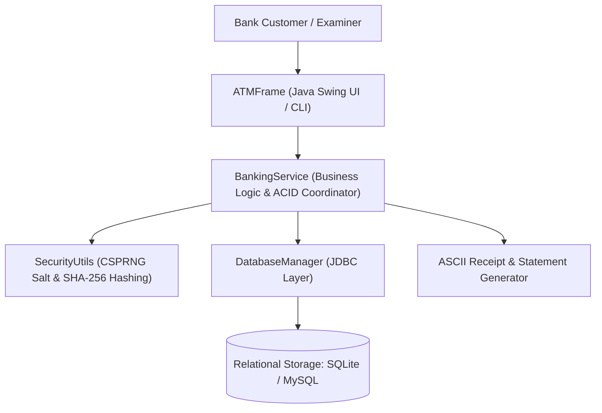
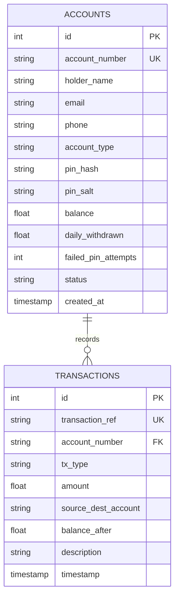
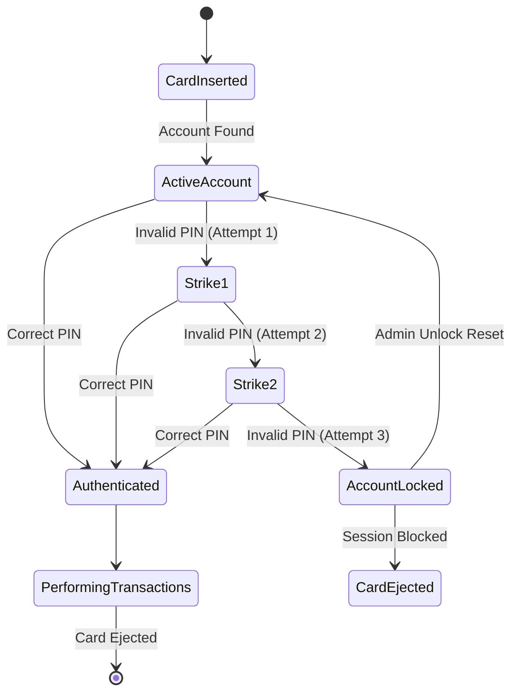
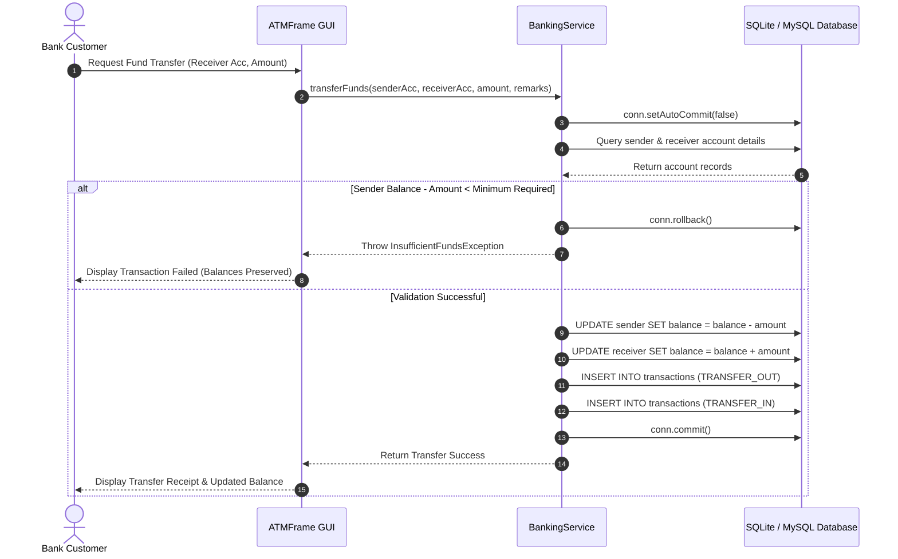

# Academic Project Report: JV-01 Online Banking and ATM Simulation

**Department of Computer Science and Engineering**  
*Undergraduate Minor Project Suite — Logic Legend*

---

## Abstract
Automated Teller Machines (ATMs) and digital banking platforms require stringent fault tolerance, strict transactional atomicity, and resilient security defenses against brute-force intrusion. The **Online Banking and ATM Simulation** is an enterprise-grade desktop software system developed in Java 21 utilizing Swing, JDBC, SQLite, and MySQL. It simulates full ATM lifecycle operations, including salted SHA-256 PIN authentication, an automated 3-strike lockout security state machine, denomination-aware cash dispensing, cash deposits, ACID-compliant atomic inter-bank fund transfers with automated rollback, chronological mini-statement generation, and printable receipts.

---

## System Architecture

---

## Entity-Relationship Diagram (ERD)

---

## State Diagram: 3-Strike PIN Lockout Security State Machine

---

## Sequence Diagram: Atomic Fund Transfer with ACID Guarantee

---

## Mathematical Denomination Dispenser Model
When dispensing an amount $W$, the ATM applies a greedy denomination strategy across standard Indian banknotes $D = \{d_1, d_2, d_3, d_4\} = \{2000, 500, 200, 100\}$:
$$\text{For } i = 1 \text{ to } 4:$$
$$n_i = \left\lfloor \frac{R_{i-1}}{d_i} \right\rfloor, \quad R_i = R_{i-1} \pmod{d_i}$$
Where $R_0 = W$.
For instance, given $W = 3,800$:
- $d_1 = 2000 \implies n_1 = \lfloor 3800 / 2000 \rfloor = 1$, Remainder $R_1 = 1800$
- $d_2 = 500 \implies n_2 = \lfloor 1800 / 500 \rfloor = 3$, Remainder $R_2 = 300$
- $d_3 = 200 \implies n_3 = \lfloor 300 / 200 \rfloor = 1$, Remainder $R_3 = 100$
- $d_4 = 100 \implies n_4 = \lfloor 100 / 100 \rfloor = 1$, Remainder $R_4 = 0$
Total notes dispensed: $1 + 3 + 1 + 1 = 6$ notes.

---

## Conclusion
The JV-01 Online Banking and ATM Simulation application provides a complete, fault-tolerant, and secure implementation of commercial ATM terminal software. With self-contained embedded SQLite persistence, 30 automated test assertions, and an intuitive Java Swing GUI, the project sets an exemplary standard for undergraduate academic evaluations.

