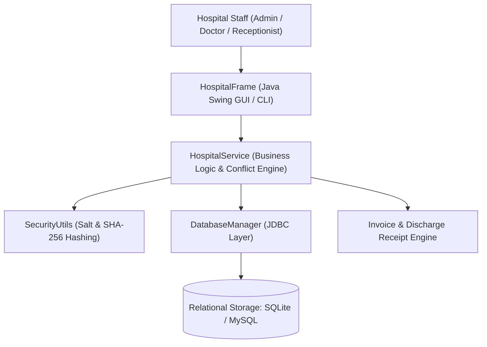
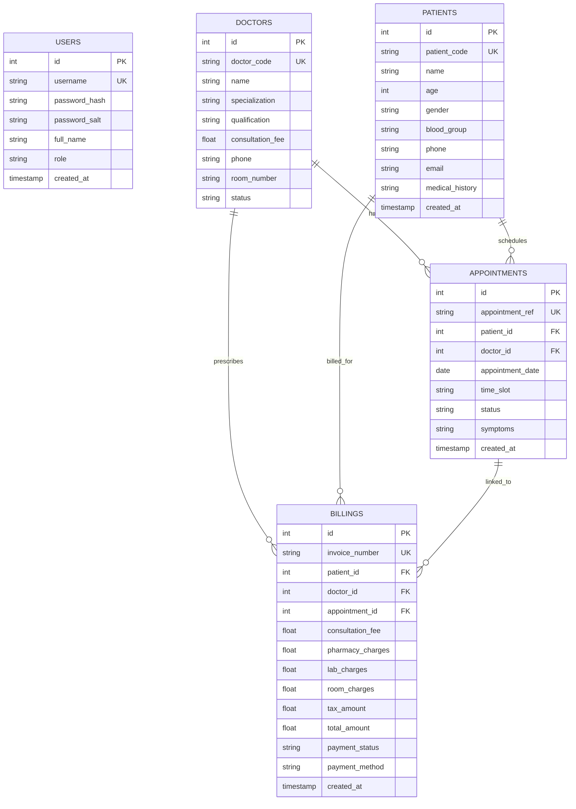
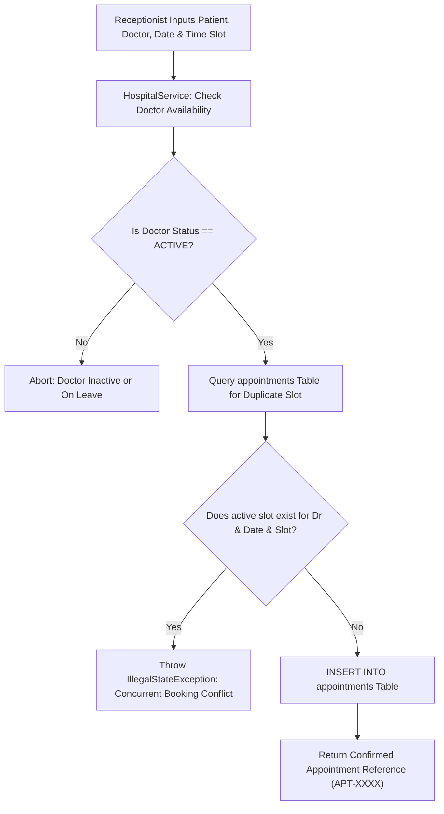
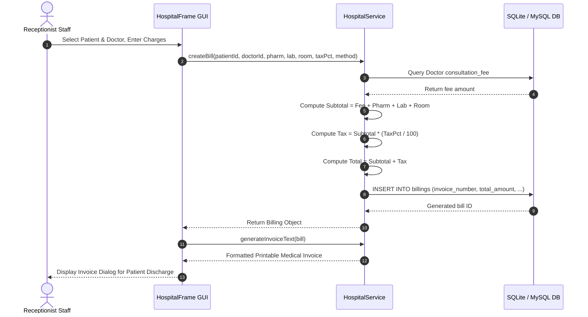

# Academic Project Report: JV-02 Hospital Management System

**Department of Computer Science and Engineering**  
*Undergraduate Minor Project Suite — Logic Legend*

---

## Abstract
Healthcare institutions face complex operational workflows involving patient registration, specialized medical consultations, appointment scheduling, and multi-departmental billing. Manual or loosely organized systems frequently cause appointment overlaps, billing miscalculations, and unauthorized staff access. This report details the design and implementation of **Hospital Management System**, an enterprise software application developed in Java 21, Swing, JDBC, SQLite, and MySQL. The system enforces Role-Based Access Control (RBAC), prevents concurrent doctor time-slot scheduling conflicts via database-level partial unique indexes, manages complete patient medical histories, and generates itemized billing invoices.

---

## System Architecture

---

## Entity-Relationship Diagram (ERD)

---

## Data Flow Diagram: Appointment Booking & Conflict Prevention

---

## Sequence Diagram: Patient Consultation & Billing Workflow

---

## Mathematical Formulation of Invoicing
The total billing calculation implements standard multi-tier medical itemization:
$$S = C_{\text{doctor}} + C_{\text{pharmacy}} + C_{\text{lab}} + C_{\text{room}}$$
$$T = S \times \left(\frac{\tau}{100}\right)$$
$$\text{Total Amount Payable} = S + T$$
Where:
- $C_{\text{doctor}}$ is the attending specialist consultation fee.
- $C_{\text{pharmacy}}$ is the prescription medication total.
- $C_{\text{lab}}$ is the pathology/diagnostic testing total.
- $C_{\text{room}}$ is the bed/ward stay charge.
- $\tau$ is the applicable Goods & Services Tax (GST) rate in percent.

---

## Conclusion
The JV-02 Hospital Management System delivers an integrated clinical operations platform combining role-based data security, real-time appointment conflict elimination, and accurate financial invoicing. Built on zero-configuration embedded SQLite with full MySQL enterprise script support, it provides a sound foundation for academic submission and live demonstration.

