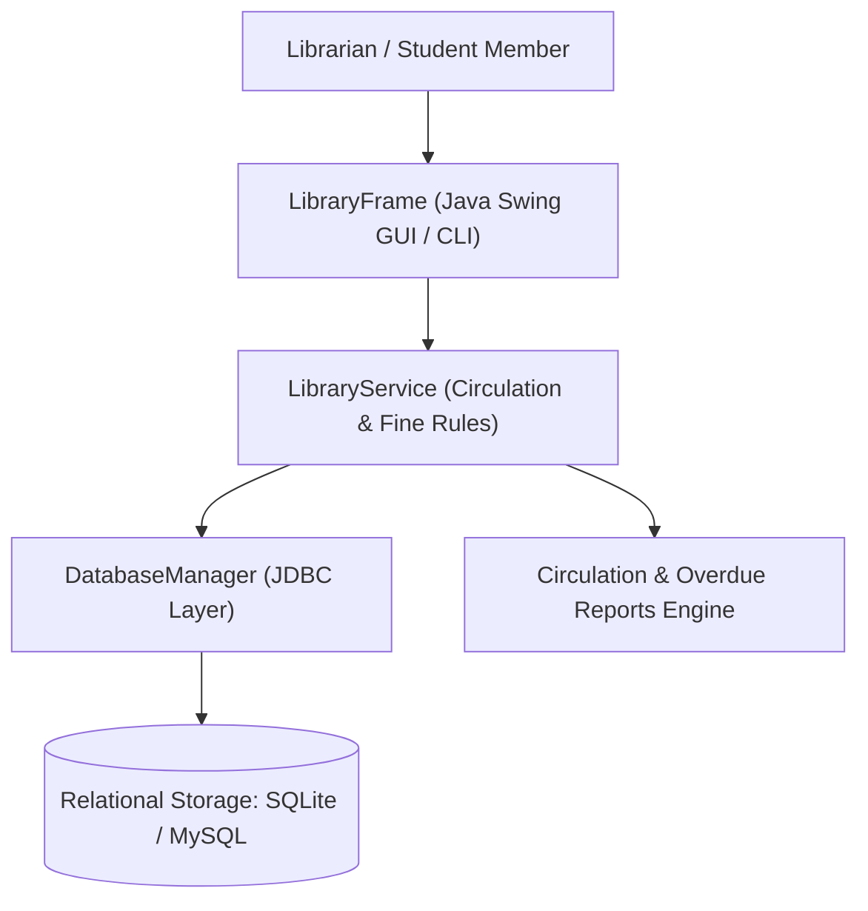
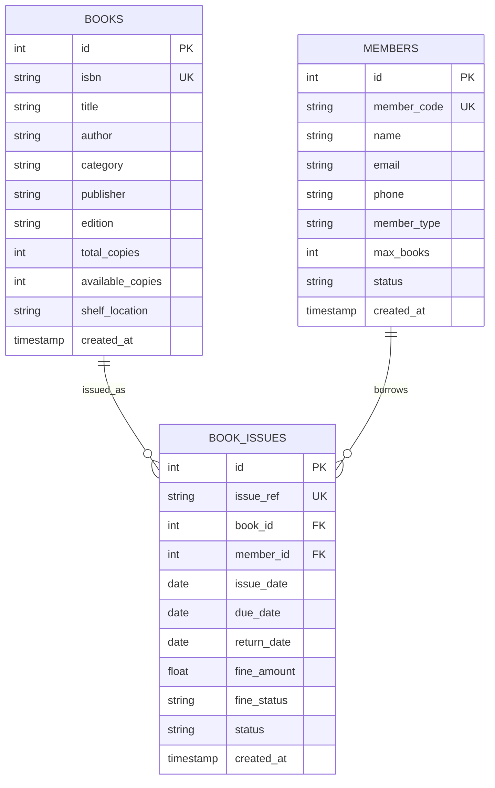
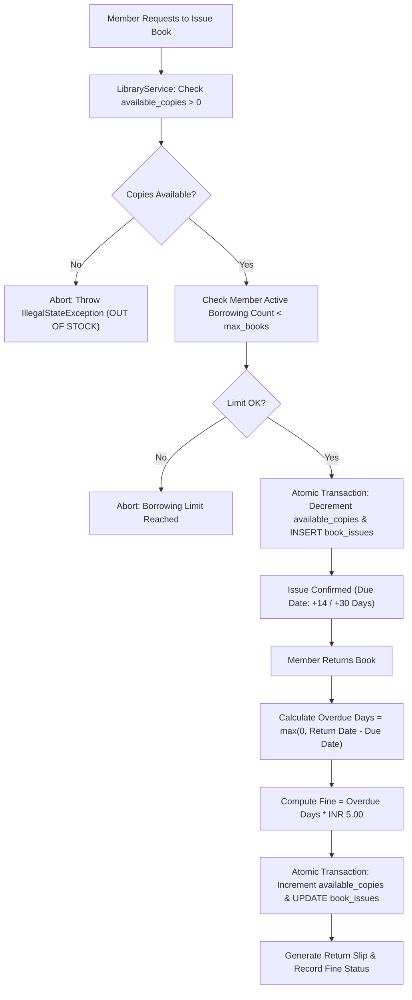
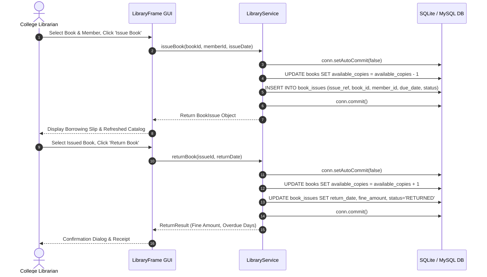

# Academic Project Report: JV-03 Library Management System

**Department of Computer Science and Engineering**  
*Undergraduate Minor Project Suite — Logic Legend*

---

## Abstract
University libraries handle extensive catalogs spanning multiple academic disciplines and manage concurrent book borrowings across student and faculty communities. Manual circulation systems or disjointed spreadsheets frequently lead to lost inventory, uncollected overdue fines, and borrowing limit violations. This report presents the architectural design, implementation, and verification of **Library Management System**, an enterprise software application developed in Java 21, Swing, JDBC, SQLite, and MySQL. The system automates catalog indexing, enforces role-differentiated borrowing thresholds, guarantees atomic inventory decrements/increments upon issue/return, executes automatic daily fine calculations, and generates circulation analytics.

---

## System Architecture

---

## Entity-Relationship Diagram (ERD)

---

## Data Flow Diagram: Book Circulation & Return Fine Workflow

---

## Sequence Diagram: Book Issue and Return

---

## Mathematical Formulation of Fines
Let $D_{\text{due}}$ be the designated return due date and $D_{\text{return}}$ be the actual return date:
$$\Delta = \text{DAYS}(D_{\text{return}} - D_{\text{due}})$$
$$\text{Overdue Days } O = \begin{cases} \Delta & \text{if } \Delta > 0 \\ 0 & \text{if } \Delta \le 0 \end{cases}$$
$$\text{Late Fine Payable } F = O \times R_{\text{daily}}$$
Where $R_{\text{daily}} = \text{INR 5.00}$.

---

## Conclusion
The JV-03 Library Management System delivers an efficient, reliable, and mathematically verified solution for academic libraries. Incorporating strict transactional integrity, role-differentiated circulation policies, automatic overdue calculations, and zero-configuration portability, the project satisfies all university examination and practical demonstration standards.

