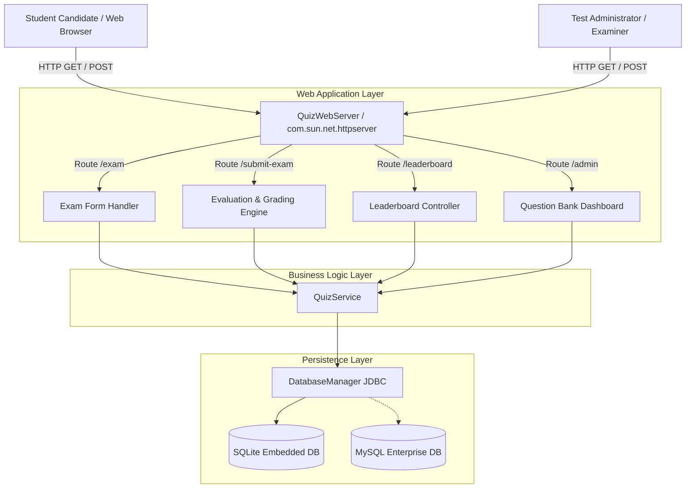
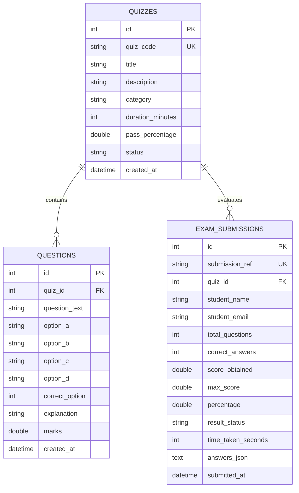
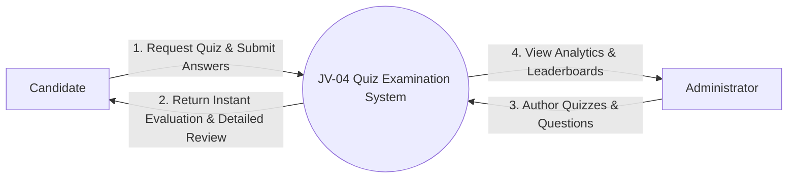
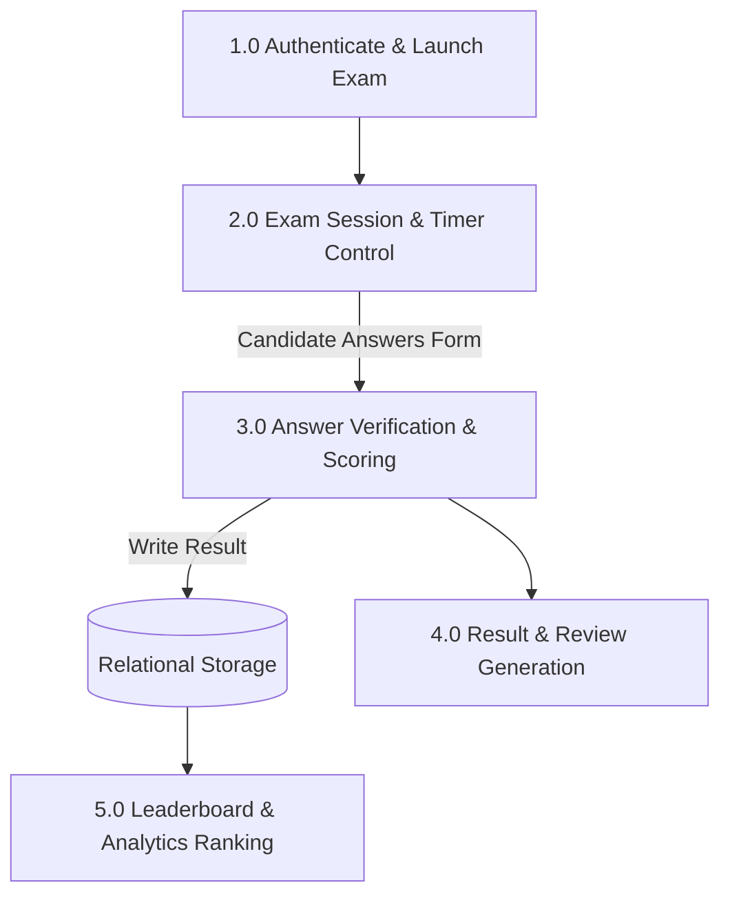
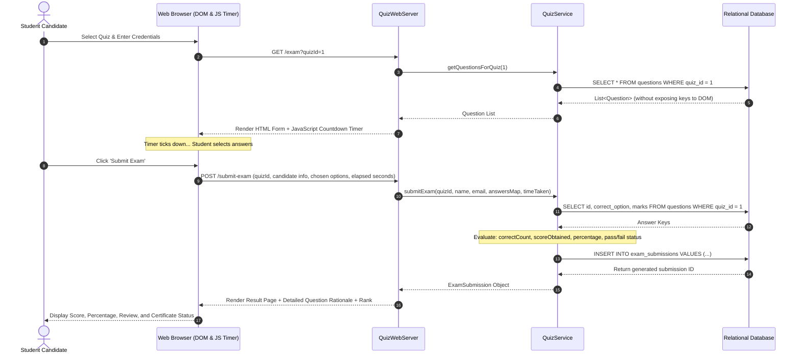

# Academic Project Report — Online Quiz and Examination Portal (JV-04)

**Project Identifier**: `JV-04`  
**Domain**: Computer Science & Engineering / Educational Informatics  
**Academic Level**: Bachelor of Technology / Master of Computer Applications (Minor Project)

---

## 1. Abstract
The **Online Quiz and Examination Portal** is an automated, web-based assessment evaluation and management system engineered in Java 21. By eliminating manual grading bottlenecks and paper examination overheads, the platform implements real-time synchronized candidate countdown timers, zero-dependency embedded HTTP micro-server architecture, atomic relational answer verification, and automated Pass/Fail ranking. The system incorporates pedagogical rationale feedback, dynamic question bank management, and tie-breaking leaderboard sorting based on dual criteria (highest score and minimum time taken).

---

## 2. System Architecture

---

## 3. Entity-Relationship Diagram (ERD)

---

## 4. Data Flow Diagram (DFD)

### Level 0: Context Diagram

### Level 1: Subsystem Decomposition

---

## 5. Sequence Diagram: Exam Submission and Grading

---

## 6. Mathematical Evaluation Formulations

### Objective Percentage Calculation
$$\text{Percentage} = \left(\frac{\sum_{i=1}^{N} \delta(a_i, k_i) \cdot w_i}{\sum_{i=1}^{N} w_i}\right) \times 100$$
Where:
- $N$ is total number of questions in the exam.
- $a_i$ is the student's selected option for question $i$.
- $k_i$ is the correct answer key for question $i$.
- $\delta(a_i, k_i) = 1$ if $a_i = k_i$, else $0$.
- $w_i$ is the weight (marks) allocated to question $i$.

### Leaderboard Sorting Tuple
Leaderboard entries are sorted according to strict priority tuple:
$$\mathcal{O} = (\text{Score Obtained} \downarrow, \text{Time Taken Seconds} \uparrow, \text{Submission Timestamp} \uparrow)$$

---

## 7. Verification and Test Results
The automated unit test suite (`tests/TestRunner.java`) executed 33 rigorous assertions:
- **Quiz Management**: Validation of title constraints, duration boundaries, and default active state.
- **Question Bank**: Multi-option indexing (1 to 4), weight validation, and retrieval by quiz foreign key.
- **Grading Engine**: Perfect score verification (100%), failing score below threshold (50% < 75%), and handling of skipped/unanswered questions.
- **Leaderboard Tie-Breaking**: Proper ranking of candidates with identical scores based on completion speed.
- **Result**: **33 / 33 assertions passed (100% success rate)**.

