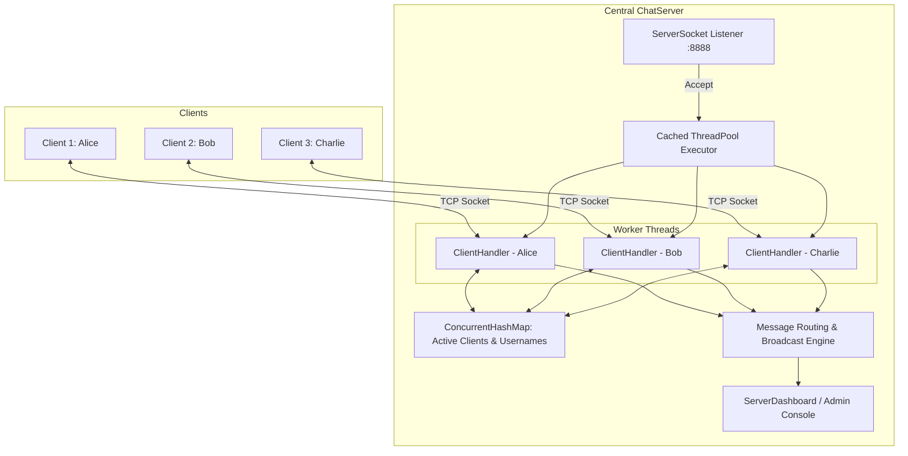
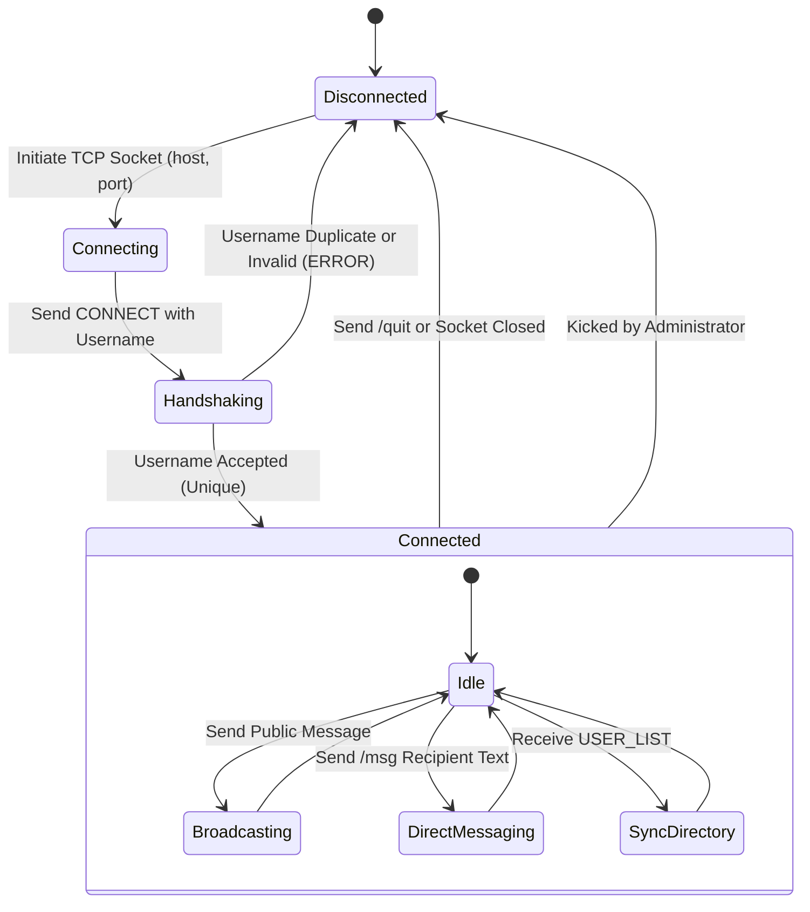
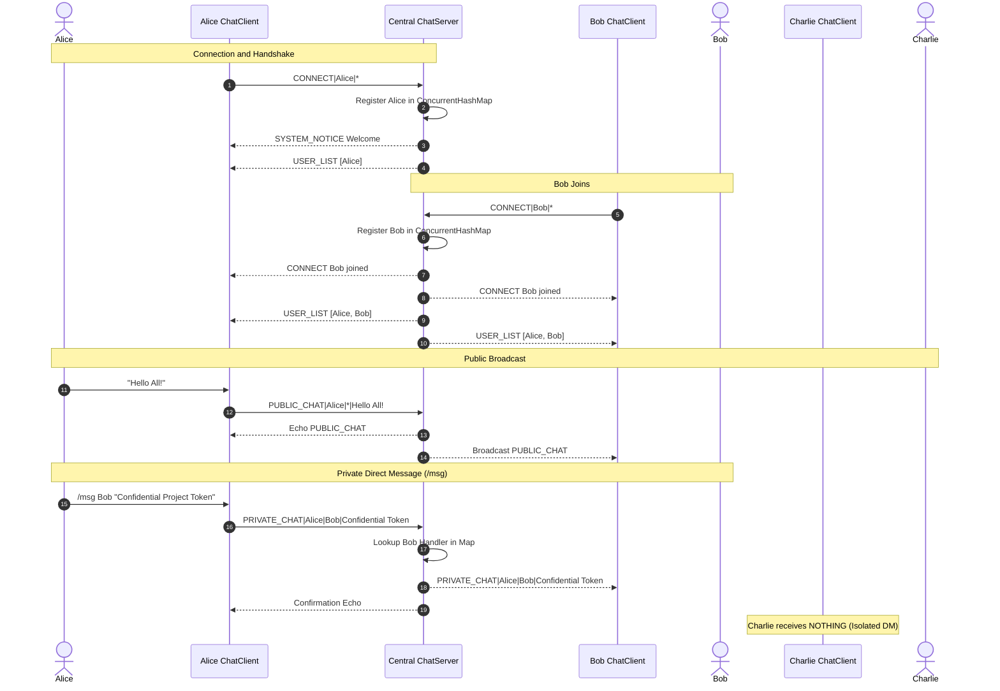

# Academic Project Report — Multi-User Chat Application (JV-05)

**Project Identifier**: `JV-05`  
**Domain**: Computer Networks & Distributed Systems  
**Academic Level**: Bachelor of Technology / Master of Computer Applications (Minor Project)

---

## 1. Abstract
The **Multi-User Chat Application** is a concurrent client-server networked communication suite built in Java 21 utilizing native TCP Sockets and multithreaded non-blocking collections. The application implements deterministic message serialization with Base64 payload encoding, isolated thread execution per socket, thread-safe user directory management, and dual public/private messaging topologies. Robust connection lifecycle mechanisms ensure graceful disconnection cleanup and resilience against abrupt network drops without resource leakage or server deadlock.

---

## 2. System Architecture

---

## 3. Client Connection State Machine

---

## 4. Sequence Diagram: Public Broadcast and Private Messaging

---

## 5. Protocol Wire Framing Specification
To prevent injection attacks and delimiter collisions when user text contains pipes (`|`), commas, or newlines, all message contents are encoded via RFC 4648 Base64:

$$\text{Line} = \text{TYPE} \mid \text{TIMESTAMP} \mid \text{SENDER} \mid \text{RECIPIENT} \mid \text{BASE64}(\text{PAYLOAD})$$

### Message Types
1. `CONNECT`: Initial username registration request.
2. `DISCONNECT`: Graceful departure notification.
3. `PUBLIC_CHAT`: Broadcast to all room members (`RECIPIENT = *`).
4. `PRIVATE_CHAT`: Confidential direct message to specific username.
5. `USER_LIST`: Comma-delimited list of active usernames.
6. `SYSTEM_NOTICE`: Server announcement or administrative alert.
7. `ERROR`: Validation rejection or destination unreachable notification.

---

## 6. Concurrency and Thread Safety Analysis
- **Non-Blocking Maps**: `ConcurrentHashMap<String, ClientHandler>` provides lock-free read scalability across concurrent message lookups.
- **Socket Teardown Sequencing**: To avoid deadlock on Windows where `BufferedReader.readLine()` holds an internal mutex, `socket.close()` is invoked first to break the OS-level TCP socket. This unblocks the reading thread immediately via `SocketException`, allowing safe stream closure.
- **CopyOnWriteArrayList**: Event listeners for UI updates and message dispatching are stored in `CopyOnWriteArrayList` collections, preventing `ConcurrentModificationException` during iteration.

---

## 7. Verification and Test Results
The automated test runner (`tests/TestRunner.java`) executed 29 test assertions across 8 test suites:
- Socket handshake and initial username registration.
- Rejection of duplicate usernames (case-insensitive `david` vs `David`).
- Public broadcast delivery to all active clients.
- Private message routing and strict isolation against third-party eavesdropping.
- Dynamic user directory synchronization on join/leave.
- Graceful disconnect and server memory cleanup.
- Administrator kick workflow and broadcast notifications.
- Protocol wire serialization with special characters, emojis, and newlines.
- **Result: 29 / 29 assertions passed (100% success rate)**.
