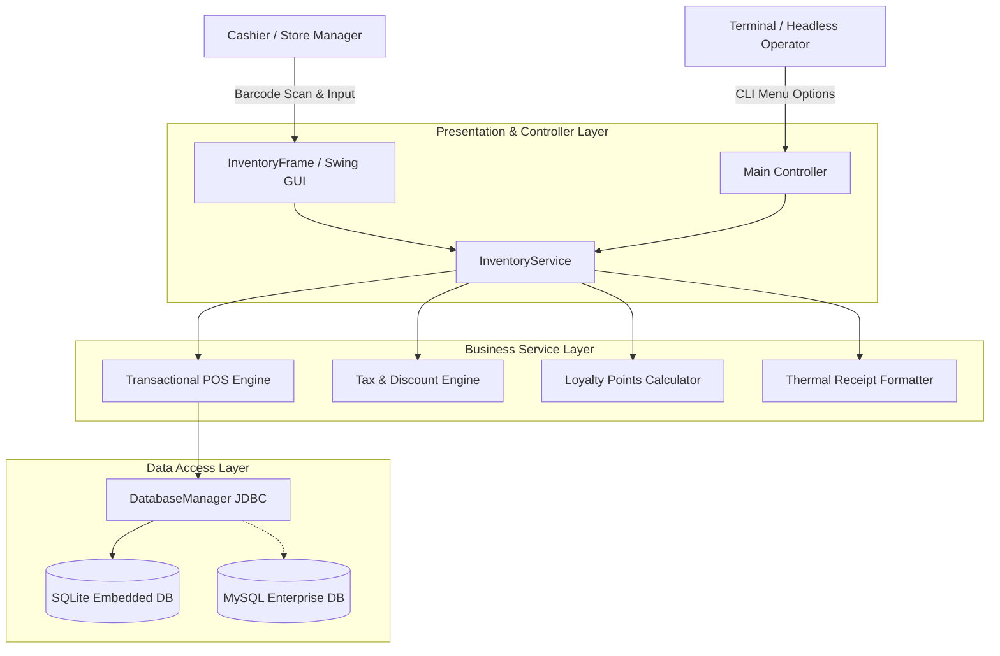
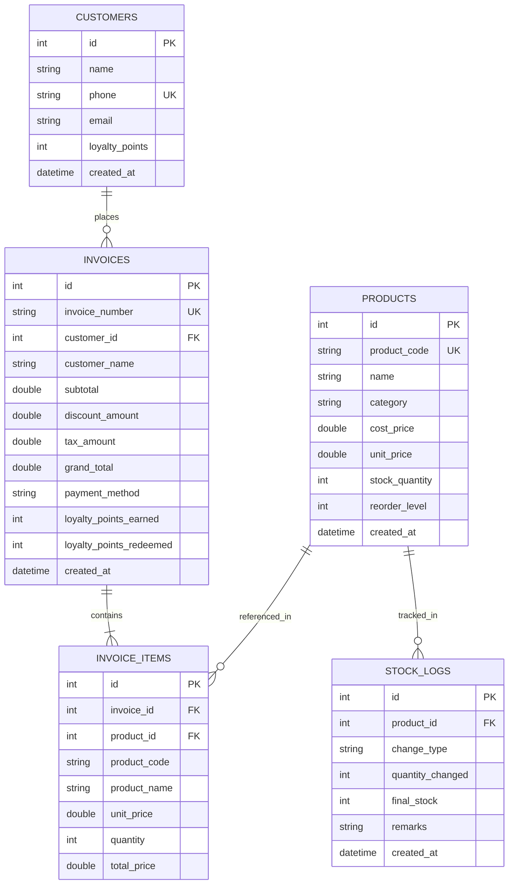
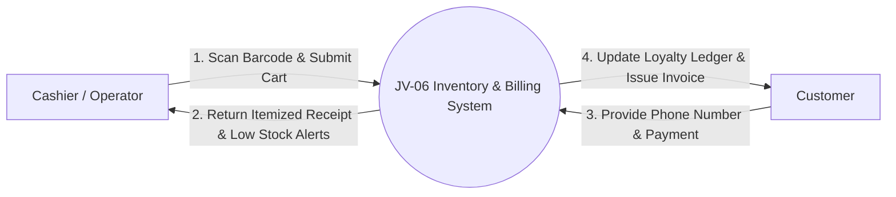
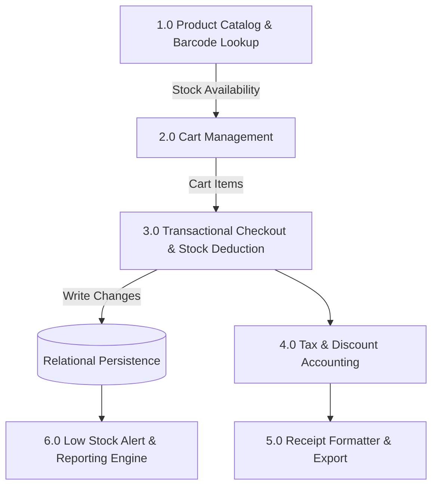
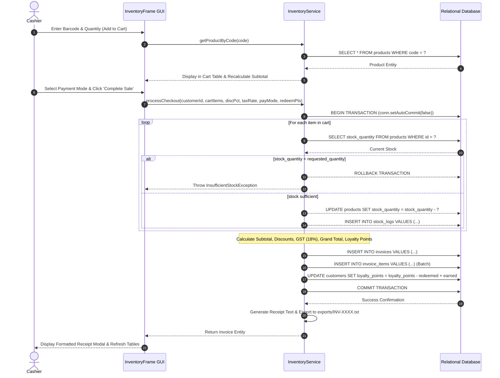

# Academic Project Report — Inventory and Billing System (JV-06)

**Project Identifier**: `JV-06`  
**Domain**: Enterprise Resource Planning (ERP) & Retail Informatics  
**Academic Level**: Bachelor of Technology / Master of Computer Applications (Minor Project)

---

## 1. Abstract
The **Inventory and Billing System** is an integrated Point-of-Sale (POS) and inventory replenishment platform engineered in Java 21. By combining barcode search, atomic transactional stock reservation, tiered discount and Goods and Services Tax (GST) computation, and customer loyalty rewards, the system guarantees that sales cannot exceed on-hand inventory levels. The platform enforces strict ACID guarantees across concurrent sales, generates itemized ASCII receipts, tracks stock history logs, and produces real-time financial turnover metrics.

---

## 2. System Architecture

---

## 3. Entity-Relationship Diagram (ERD)

---

## 4. Data Flow Diagram (DFD)

### Level 0: Context Diagram

### Level 1: Subsystem Decomposition

---

## 5. Sequence Diagram: POS Transactional Checkout

---

## 6. Financial Formulations & Business Rules

### Itemized Calculations
$$\text{Line Total}_i = \text{unit\_price}_i \times \text{quantity}_i$$
$$\text{Subtotal} = \sum_{i=1}^{M} \text{Line Total}_i$$

### Discount Compounding
$$\text{Promotional Discount} = \text{Subtotal} \times \left(\frac{D_{\text{pct}}}{100}\right)$$
$$\text{Loyalty Discount} = P_{\text{redeem}} \times 1.0$$
$$\text{Total Discount} = \min(\text{Subtotal}, \text{Promotional Discount} + \text{Loyalty Discount})$$

### Tax & Final Payable
$$\text{Taxable Amount} = \text{Subtotal} - \text{Total Discount}$$
$$\text{GST Amount} = \text{Taxable Amount} \times 0.18$$
$$\text{Grand Total} = \text{Taxable Amount} + \text{GST Amount}$$

---

## 7. Verification and Test Results
The automated test runner (`tests/TestRunner.java`) executed 41 assertions across 9 test suites:
- Product creation, barcode retrieval, and pricing accuracy.
- Stock replenishment and auditing of `stock_logs`.
- Real-time low stock threshold alerts (`stock_quantity <= reorder_level`).
- Atomic stock reservation and deduction upon checkout.
- Abort and rollback of sales attempting to exceed available inventory.
- Mathematical precision of discounts and 18% GST computations.
- Loyalty point accrual (+1 pt per ₹100) and point redemption (₹1/pt).
- Receipt formatting and filesystem export verification.
- Daily financial summaries (turnover, discounts, invoice count).
- **Result: 41 / 41 assertions passed (100% success rate)**.

