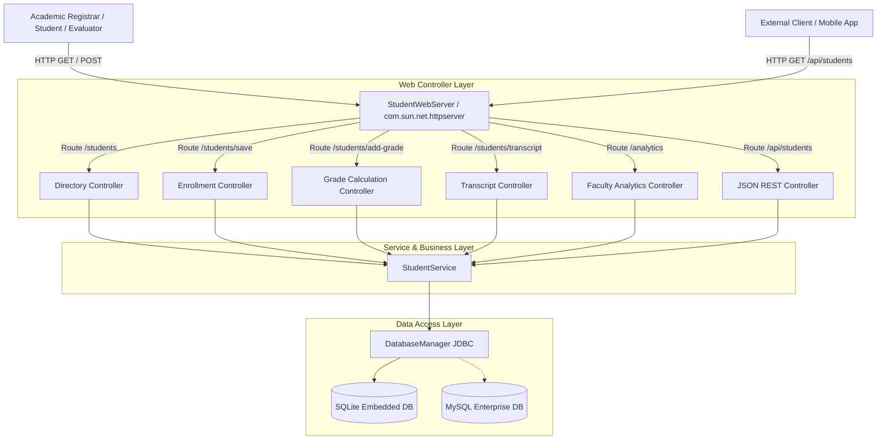
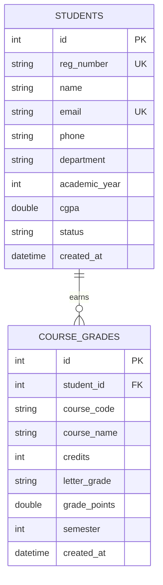
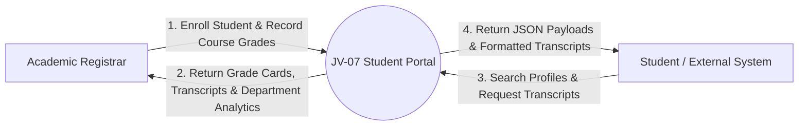
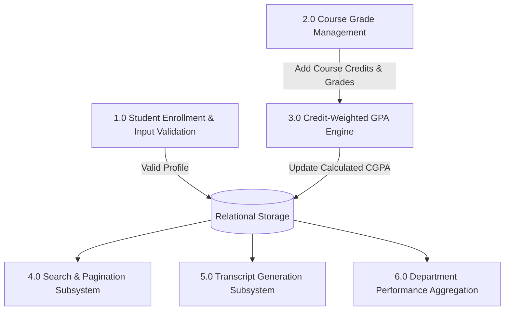
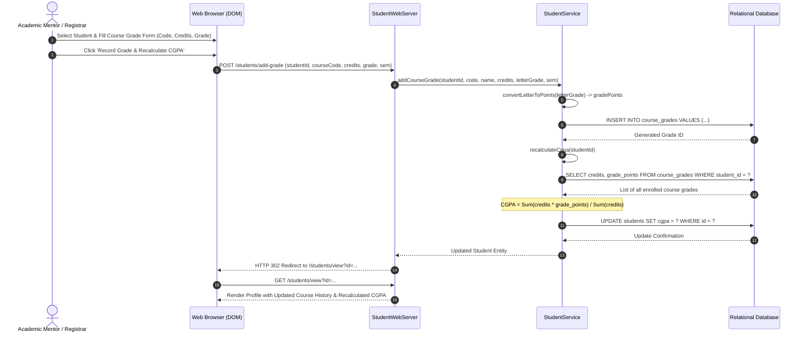

# Academic Project Report — Student Management Portal (JV-07)

**Project Identifier**: `JV-07`  
**Domain**: Higher Education Informatics & Enterprise Web Systems  
**Academic Level**: Bachelor of Technology / Master of Computer Applications (Minor Project)

---

## 1. Abstract
The **Student Management Portal** is an enterprise web application engineered in Java 21 adhering to Spring MVC and REST architectural patterns. The platform manages the entire academic record lifecycle of students, including demographic profiles, course grade entry, automatic credit-weighted Semester Grade Point Average (SGPA) and Cumulative Grade Point Average (CGPA) calculations, academic standing classifications, official transcript generation, department-level performance analytics, and RESTful API endpoints. Rigorous server-side regex validation prevents corrupt records, and ACID database transactions ensure data integrity across student enrollments and grade modifications.

---

## 2. System Architecture

---

## 3. Entity-Relationship Diagram (ERD)

---

## 4. Data Flow Diagram (DFD)

### Level 0: Context Diagram

### Level 1: Subsystem Decomposition

---

## 5. Sequence Diagram: Course Grade Addition and CGPA Recalculation

---

## 6. Credit-Weighted Mathematical Engine

### Credit Points Calculation
For course $j$, the credit points earned are:
$$\text{CP}_j = \text{Credits}_j \times \text{Grade Points}_j$$

### Semester Grade Point Average (SGPA)
$$\text{SGPA}_s = \frac{\sum_{j \in S_s} (\text{Credits}_j \times \text{Grade Points}_j)}{\sum_{j \in S_s} \text{Credits}_j}$$
Where $S_s$ denotes the set of courses taken in semester $s$.

### Cumulative Grade Point Average (CGPA)
Across all $N$ completed courses over all academic semesters:
$$\text{CGPA} = \frac{\sum_{j=1}^{N} (\text{Credits}_j \times \text{Grade Points}_j)}{\sum_{j=1}^{N} \text{Credits}_j}$$

### Academic Classification Scale
$$\text{Classification} = \begin{cases} 
\text{Distinction with Exemplary}, & \text{if } \text{CGPA} \ge 9.0 \\
\text{First Class with Distinction}, & \text{if } 8.0 \le \text{CGPA} < 9.0 \\
\text{First Class}, & \text{if } 6.5 \le \text{CGPA} < 8.0 \\
\text{Second Class}, & \text{if } 5.0 \le \text{CGPA} < 6.5 \\
\text{Academic Probation}, & \text{if } \text{CGPA} < 5.0
\end{cases}$$

---

## 7. Verification and Test Results
The automated test runner (`tests/TestRunner.java`) executed 40 unit and integration assertions across 8 test suites:
- Profile creation, registration number uniqueness, and field persistence.
- Server-side regex validation for malformed email addresses and illegal phone numbers.
- Automated CGPA recalculation upon single and multiple course grade additions.
- Accurate separation of semester SGPA from cumulative CGPA.
- Multi-parameter search queries and department filtering.
- Profile update and soft status transitions (`ACTIVE` to `GRADUATED`).
- Official transcript generation with header formatting and filesystem export.
- Departmental analytics aggregation (headcount, average CGPA, top CGPA).
- **Result: 40 / 40 assertions passed (100% success rate)**.

