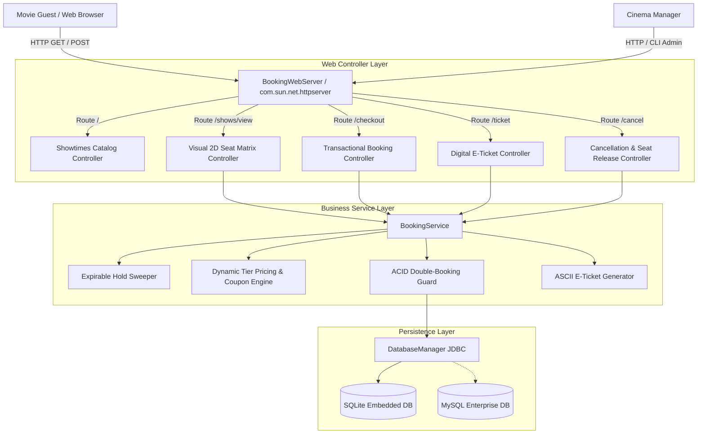
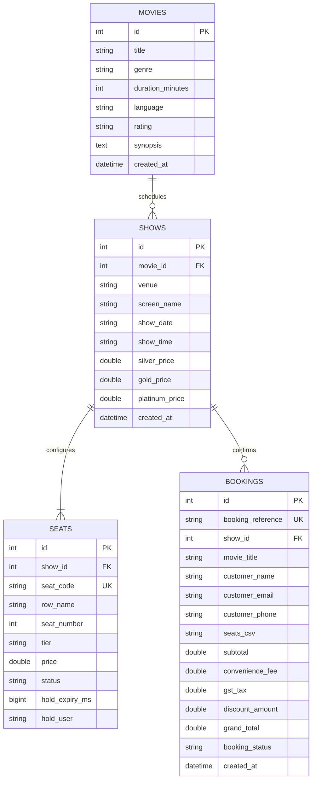
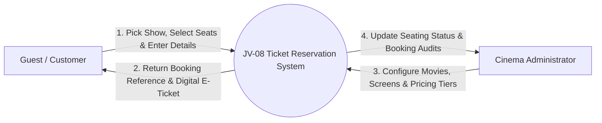
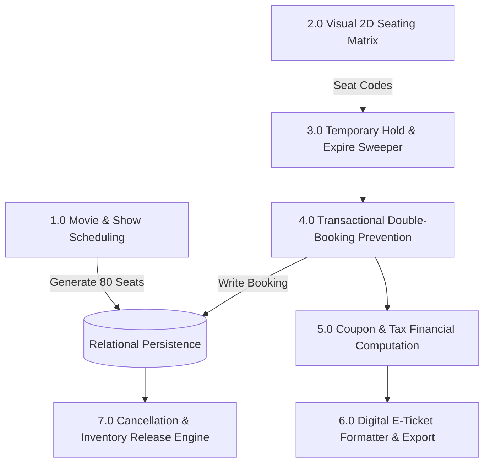
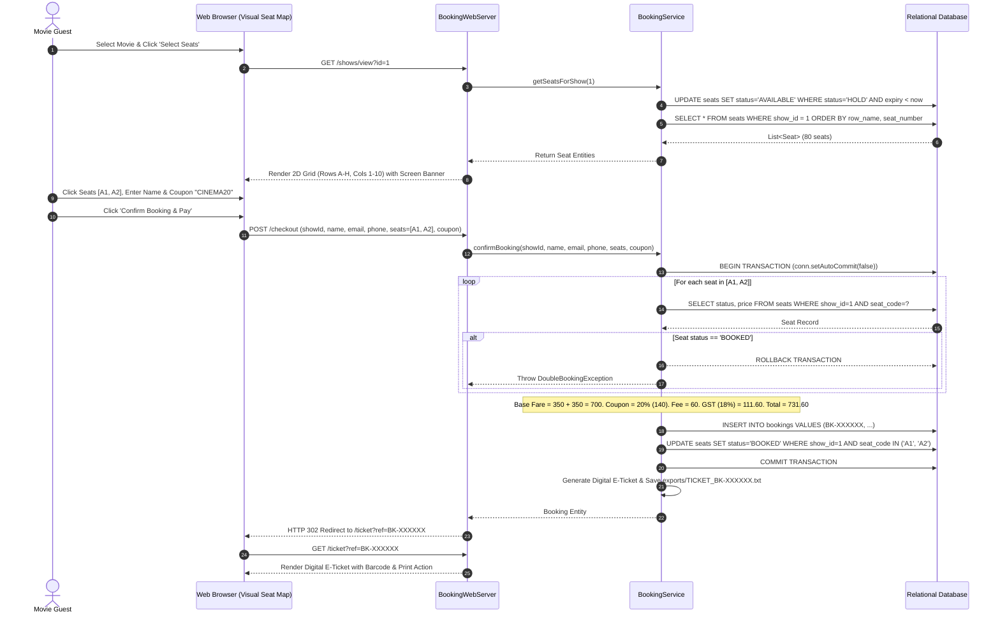

# Academic Project Report — Movie or Event Ticket Booking System (JV-08)

**Project Identifier**: `JV-08`  
**Domain**: Entertainment Informatics & High-Concurrency Reservation Systems  
**Academic Level**: Bachelor of Technology / Master of Computer Applications (Minor Project)

---

## 1. Abstract
The **Movie or Event Ticket Booking System** is an interactive cinema reservation and ticketing platform engineered in Java 21. By combining visual 2D seating layouts, multi-tier pricing structures (Platinum, Gold, Silver), expirable temporary seat holds, and atomic ACID transactions, the system prevents concurrent double-booking collisions. The platform integrates promotional coupon discounting, statutory 18% entertainment tax calculations, digital e-ticket generation with simulated barcodes, and a self-service cancellation portal that restores released seats back into active inventory.

---

## 2. System Architecture



---

## 3. Entity-Relationship Diagram (ERD)



---

## 4. Data Flow Diagram (DFD)

### Level 0: Context Diagram


### Level 1: Subsystem Decomposition


---

## 5. Sequence Diagram: Visual Seat Selection and Transactional Checkout



---

## 6. Temporary Expirable Seat Hold Algorithm
To prevent race conditions during customer form input while avoiding permanently locked seats if a user abandons their browser tab:
1. When seats are held, the system sets:
   $$\text{hold\_expiry\_ms} = \text{System.currentTimeMillis()} + (\Delta t \times 1000)$$
2. Whenever `getSeatsForShow()` or `confirmBooking()` is invoked, an automated sweep releases stale holds:
   ```sql
   UPDATE seats SET status = 'AVAILABLE', hold_expiry_ms = 0, hold_user = NULL
   WHERE show_id = ? AND status = 'HOLD' AND hold_expiry_ms < ?;
   ```
3. This eliminates background polling threads while maintaining zero stale holds.

---

## 7. Financial & Statutory Tax Formulations
$$\text{Base Fare} = \sum_{s \in \text{Seats}} \text{Price}(s)$$
$$\text{Convenience Fee} = |\text{Seats}| \times 30.00$$
$$\text{Discount} = \begin{cases} \min(150, \text{Base Fare} \times 0.20), & \text{if Coupon} = \text{"CINEMA20"} \\ \min(\text{Base Fare}, 50), & \text{if Coupon} = \text{"MOVIE50"} \\ 0, & \text{otherwise} \end{cases}$$
$$\text{Taxable Amount} = \max(0, \text{Base Fare} - \text{Discount}) + \text{Convenience Fee}$$
$$\text{GST Amount (18\%)} = \text{Taxable Amount} \times 0.18$$
$$\text{Grand Total} = \text{Taxable Amount} + \text{GST Amount}$$

---

## 8. Verification and Test Results
The automated test runner (`tests/TestRunner.java`) executed 44 assertions across 8 test suites:
- Movie and show scheduling with automated 80-seat matrix initialization.
- Dynamic pricing tier distribution (Rows A-B Platinum, C-F Gold, G-H Silver).
- Successful seat reservation and status locking.
- Rejection and transactional rollback of concurrent double-booking attempts.
- Temporary expirable seat holds and automatic post-expiration release.
- Financial arithmetic: promotional coupons, convenience fees, and 18% GST.
- Booking cancellation and immediate seat release back to active inventory.
- Digital e-ticket formatting, ASCII barcode rendering, and filesystem exports.
- **Result: 44 / 44 assertions passed (100% success rate)**.

