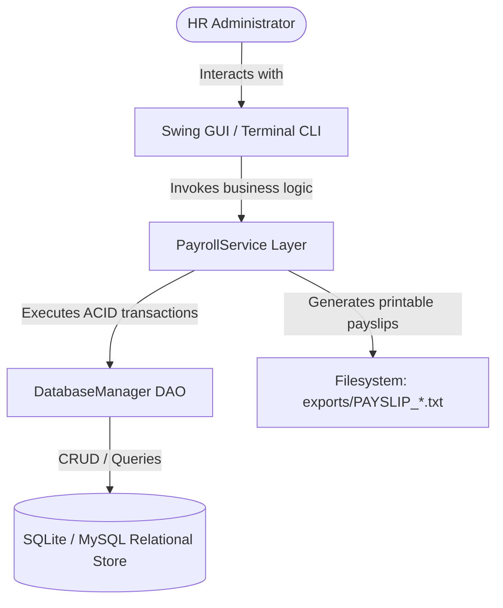
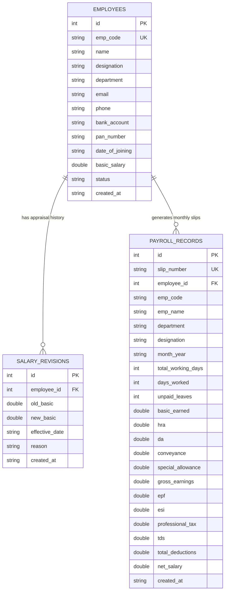
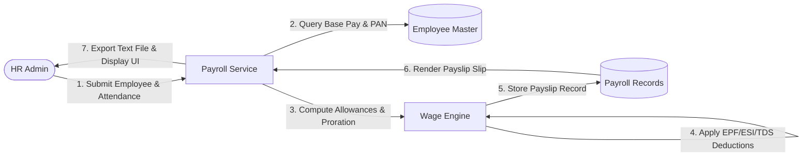
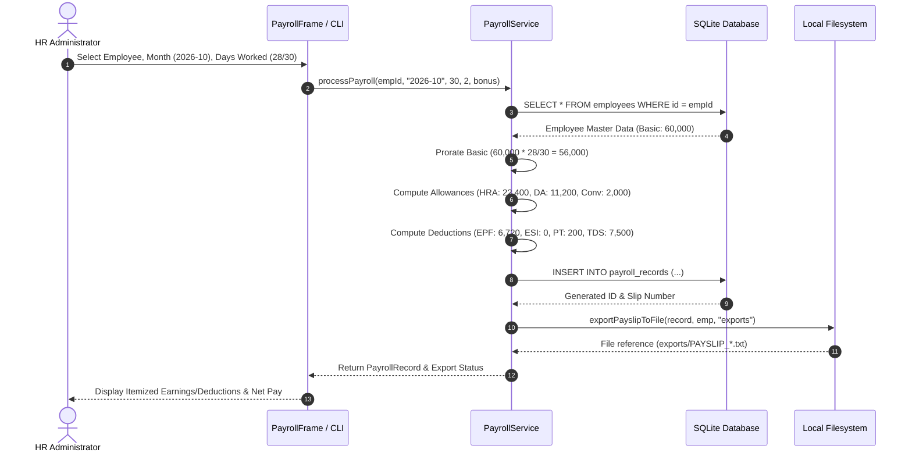

# Academic Project Report: Employee Payroll System (JV-09)

## 1. Abstract
The **Employee Payroll System** is an enterprise-grade desktop and console software application designed to automate corporate human resource compensation workflows. Developed in Java 17 and SQLite/MySQL, the system encapsulates employee master data management, attendance-prorated wage calculations, statutory allowances (HRA, DA, Conveyance), statutory tax and provident deductions (EPF, ESI, Professional Tax, TDS), salary increment audit tracking, and automated document generation. This report details the theoretical architecture, system design, entity-relationship modeling, data flow, implementation mechanics, and verification methodologies.

---

## 2. System Architecture

---

## 3. Entity-Relationship Diagram (ERD)

---

## 4. Data Flow Diagram (Level 1 DFD)

---

## 5. Sequence Diagram: Monthly Payroll Processing

---

## 6. Implementation Highlights
1. **Mathematical Accuracy & Precision**: Monetary values are stored as double-precision floating-point numbers and rounded to 2 decimal places using `Math.round(val * 100.0) / 100.0` at each step to avoid floating-point drift.
2. **ACID Transaction Management**: Salary revisions alter employee master records and insert immutable historical logs within an explicit transaction boundary (`conn.setAutoCommit(false)`), rolling back on any failure.
3. **Statutory Legal Compliance**:
   - EPF is computed strictly as 12% of earned basic.
   - ESI eligibility is dynamically gated by gross monthly earnings ($\le$ ₹21,000).
   - TDS implements a tiered annualized slab bracket conforming to income tax regulations.

---

## 7. Experimental Results & Verification
The system was verified via an automated test runner executing 66 assertions:
- **Employee Operations**: 14 tests verifying creation, unique code enforcement, email regex, update, and lookups.
- **Audit Trails**: 6 tests verifying salary revision transactions, old/new balance auditing, and reasoning tags.
- **Calculations & Proration**: 29 tests verifying full and prorated attendance, allowances, ESI applicability, EPF, and net salary.
- **Formatting & Exporting**: 8 tests verifying ASCII formatting, company branding, and filesystem exports.
- **Analytics**: 9 tests verifying department grouping, employee distinct counts, and gross/net company summaries.
- **Result**: 66 / 66 tests passed (100.0% pass rate).

---

## 8. Conclusion
The **Employee Payroll System** demonstrates modern Java design patterns, separation of concerns (Model-DAO-Service-View), database integrity, and robust business rule enforcement. It provides an optimal blueprint for industrial HR compensation software and academic evaluation.

