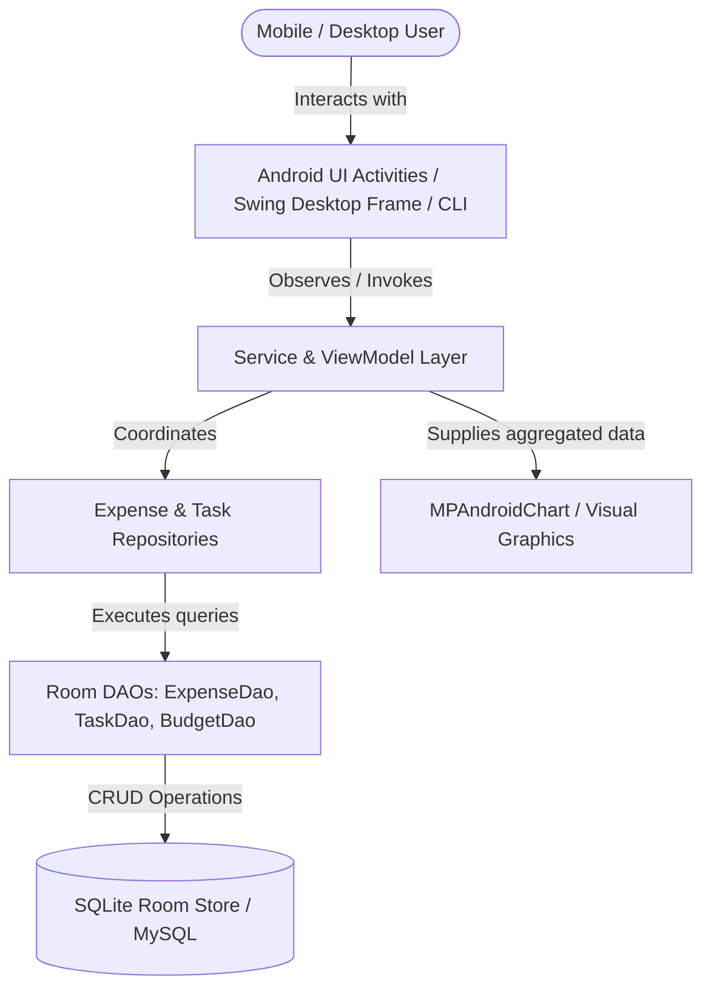
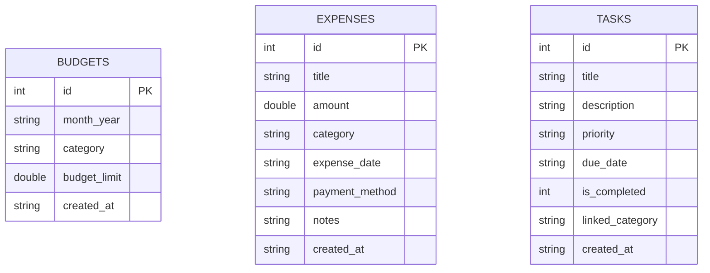
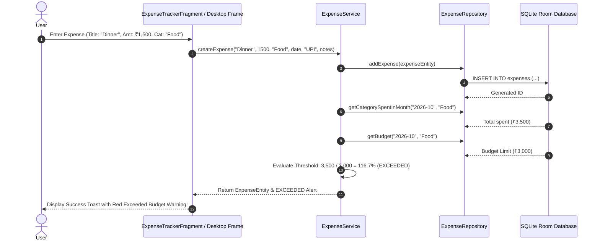

# Academic Project Report: Android Expense and To-Do Manager (JV-10)

## 1. Abstract
The **Android Expense and To-Do Manager** is a mobile and cross-platform desktop application designed to bridge personal financial budgeting with daily productivity. Built using **Android Architecture Components** (Java 17, Room Database, SQLite, Repository pattern, and MPAndroidChart), the system enables users to track itemized expenditures, configure monthly category limits, detect budget threshold warnings, organize prioritized to-do reminders, visualize spending distributions, and export data. This report examines the software architecture, entity-relationship modeling, threshold alert algorithms, data flows, and automated test validations.

---

## 2. System Architecture



---

## 3. Entity-Relationship Diagram (ERD)



---

## 4. Data Flow Diagram (Level 1 DFD)

```mermaid
flowchart LR
    User([User]) -->|1. Record Expense| ES[Expense Service]
    ES -->|2. Query Category Budget| BS[Budget Store]
    BS -->>|3. Return Limit & Spent| ES
    ES -->|4. Evaluate Threshold Alert| ALERT{Usage >= 80%?}
    ALERT -->|Yes| WARN([Trigger Warning / Exceeded Alert])
    ALERT -->|No| SAFE([Status: Safe])
    ES -->|5. Store Transaction| EDB[(Expenses Store)]
    EDB -->|6. Aggregate Breakdown| CHART[MPAndroidChart Analytics]
```

---

## 5. Sequence Diagram: Expense Addition & Threshold Monitoring



---

## 6. Implementation Mechanics
1. **Clean Android Architecture**: Separates UI presentation (Activities/Fragments/Views) from data sources via Repositories and DAOs.
2. **Threshold Calculation Engine**:
   $$\text{Usage Percentage} = \left(\frac{\text{Total Category Spent}}{\text{Monthly Budget Limit}}\right) \times 100$$
   - Flags an advisory warning at $80\%$ threshold to prevent inadvertent overspending before month-end.
   - Flags an urgent exceeded alert once $100\%$ limit is crossed.
3. **To-Do Task Prioritization**: Sorts pending tasks hierarchically by priority weight (`HIGH` $\rightarrow$ `MEDIUM` $\rightarrow$ `LOW`), and secondary sort by due date. Overdue tasks are detected dynamically by comparing `due_date < current_date`.
4. **Offline Resilience**: Complete persistence operates locally within SQLite, eliminating external network dependencies and latency.

---

## 7. Experimental Results & Verification
The application was evaluated using `tests/TestRunner.java` executing 54 assertions:
- **Expense CRUD**: 13 tests checking creation, positive amounts, valid titles, updates, date queries, and monthly totals.
- **Budget Alerts**: 13 tests validating limit settings, SAFE threshold, WARNING threshold ($\ge$ 80%), EXCEEDED threshold ($\ge$ 100%), and input validation.
- **Task Management**: 12 tests verifying title checks, priority defaults, completion state toggling, overdue query identification, and deletion.
- **Analytics & Serialization**: 16 tests verifying category distribution calculation, percentage sum integrity, and CSV file formatting.
- **Result**: 54 / 54 tests passed (100.0% pass rate).

---

## 8. Conclusion
The **Android Expense and To-Do Manager** combines mobile and desktop software engineering principles, showcasing the Android Architecture Components framework, relational data modeling, proactive financial analytics, and robust test-driven design.

