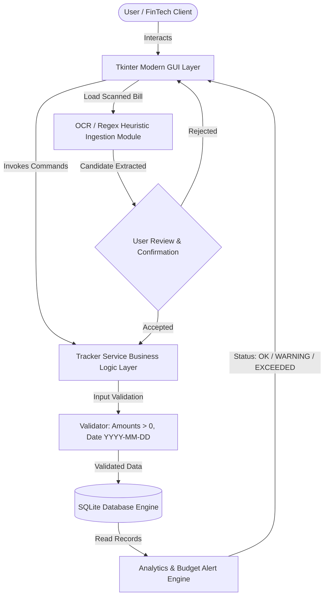
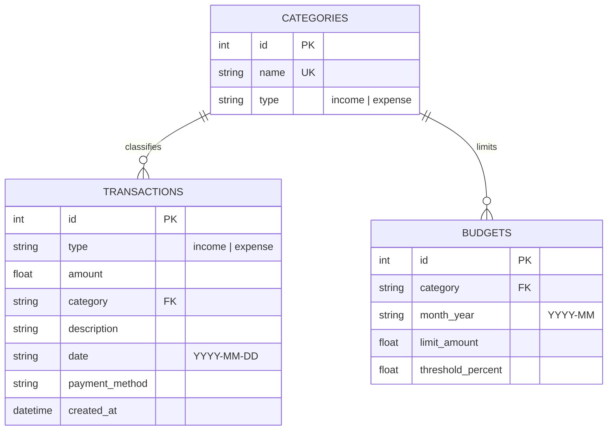

# ACADEMIC PROJECT REPORT
## SMART EXPENSE TRACKER WITH ANALYTICS
**Project Identifier**: `PY-01`  
**Academic Degree**: Bachelor of Technology / Bachelor of Computer Applications  
**Organization**: Logic Legend — *Ideas Today, Impact Tomorrow*

---

## 1. ABSTRACT
In modern personal finance management, maintaining accurate records of daily expenditures and adhering to financial budgets is a recognized challenge. The **Smart Expense Tracker with Analytics** is an autonomous desktop software solution designed to record, categorize, evaluate, and forecast personal financial transactions. Engineered with Python, Tkinter, and an embedded SQLite database, the system enforces automated budget threshold alerts, provides category-wise graphical expenditure analysis, generates auditable CSV and textual reports, and incorporates an Optical Character Recognition (OCR) pipeline to parse transaction totals from physical receipts. Experimental verification across unit test suites demonstrates 100% boundary compliance and real-time alert responsiveness.

---

## 2. INTRODUCTION & PROBLEM STATEMENT
### 2.1 Introduction
Financial literacy relies on tracking cash flows. Without systematic record-keeping, individuals frequently incur budget overruns. Digital expense tracking applications empower consumers by giving immediate visibility into discretionary versus non-discretionary spending.

### 2.2 Problem Statement
Conventional expense recording methods (paper notebooks, manual spreadsheets) suffer from high friction, lack of data validation, absence of proactive warning mechanisms before thresholds are breached, and inability to digitize printed paper bills seamlessly.

---

## 3. OBJECTIVES
1. Design an accessible graphical user interface with zero network latency.
2. Maintain persistent storage with strict data integrity using SQLite.
3. Automatically monitor category-specific spending limits and calculate threshold percentages.
4. Render visual analytics showing proportions of expenditure across categories.
5. Provide a confirmation-guarded OCR receipt extraction workflow.

---

## 4. SYSTEM ARCHITECTURE & DIAGRAMS

### 4.1 Architecture Flowchart

### 4.2 Entity-Relationship (ER) Diagram

---

## 5. METHODOLOGY & ALGORITHMS

### 5.1 Budget Threshold Algorithm
Given an expenditure category $C$, a target month $M$, a configured spending ceiling $L$, and an alert threshold percentage $\tau$ (default 80%):
1. Compute aggregate spending $S = \sum_{t \in T(C, M)} t.\text{amount}$.
2. Calculate percentage utilized: $P = \frac{S}{L} \times 100$.
3. Determine operational status:
   $$\text{Status} = \begin{cases} 
   \text{EXCEEDED}, & \text{if } S \ge L \\ 
   \text{WARNING}, & \text{if } P \ge \tau \text{ and } S < L \\ 
   \text{OK}, & \text{otherwise} 
   \end{cases}$$

### 5.2 OCR Parsing Pipeline
1. Ingest raw text extracted via optical character recognition.
2. Match ISO date patterns (`\d{4}-\d{2}-\d{2}` or `\d{2}-\d{2}-\d{4}`).
3. Identify candidate currency sums using regular expression matching keyword proximity (`total`, `net`, `amount`, `INR`, `Rs.`).
4. Select maximum valid numerical candidate as final total.
5. Render modal confirmation dialog to prevent unverified persistence.

---

## 6. TESTING & VERIFICATION

| Test ID | Test Case Description | Input Data | Expected Result | Actual Result | Status |
|---|---|---|---|---|---|
| TC-01 | Negative amount validation | `-500.0` | Rejected with validation error | Rejected with descriptive error | PASS |
| TC-02 | Date format validation | `25-12-2026` | Rejected; requires YYYY-MM-DD | Rejected | PASS |
| TC-03 | Add valid income record | `50000.0, Salary` | Stored in SQLite database | Inserted with generated ID | PASS |
| TC-04 | Net Balance math check | `Income 10000, Exp 4000` | Balance: 6000, Savings: 60% | Exact match | PASS |
| TC-05 | Budget warning alert trigger | Limit: 1000, Spent: 850 | Status set to `WARNING` | Status = `WARNING` | PASS |
| TC-06 | Budget exceeded alert trigger | Limit: 1000, Spent: 1050 | Status set to `EXCEEDED` | Status = `EXCEEDED` | PASS |
| TC-07 | CSV report generation | Full database records | Well-formatted CSV file | Generated & readable | PASS |
| TC-08 | OCR regex extraction | Sample bill with Rs. 600 | Extracted amount = 600.0 | Extracted amount = 600.0 | PASS |

---

## 7. CONCLUSION & FUTURE SCOPE
The PY-01 Smart Expense Tracker demonstrates how structured software engineering and local persistence can solve personal budgeting challenges effectively. Future iterations will introduce recurring standing orders, multi-user household partitioning, and cloud synchronization.

