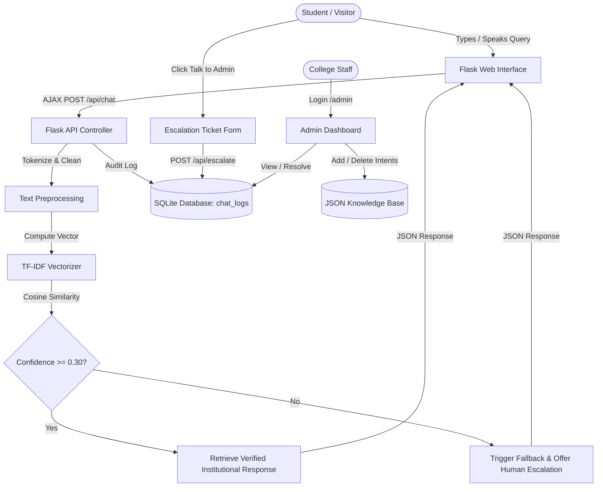
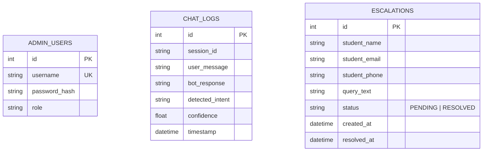

# ACADEMIC PROJECT REPORT
## AI CHATBOT FOR COLLEGE QUERIES
**Project Identifier**: `PY-02`  
**Academic Degree**: Bachelor of Technology / Bachelor of Computer Applications  
**Organization**: Logic Legend — *Ideas Today, Impact Tomorrow*

---

## 1. ABSTRACT
Automating institutional customer service and student inquiry handling has become a vital requirement in modern academic administration. The **AI Chatbot for College Queries** presents a resilient natural language processing web system developed using Python, Flask, scikit-learn, and SQLite. Employing Term Frequency-Inverse Document Frequency (TF-IDF) feature engineering and Cosine Similarity intent classification, the application resolves queries related to admissions, fee structures, examination timetables, department programs, and campus facilities. When user queries exhibit low similarity scores, a confidence-aware fallback mechanism directs students to a structured "Talk to Admin" human escalation channel. An administrative dashboard allows authorized staff to manage knowledge base intents dynamically and resolve escalation tickets.

---

## 2. INTRODUCTION & PROBLEM STATEMENT
### 2.1 Introduction
Universities and colleges receive inquiries daily from thousands of prospective and current students. Physical help desks and telephonic switchboards become bottlenecks during admissions cycles, leading to communication delays and administrative strain.

### 2.2 Problem Statement
Existing automated response systems often suffer from:
1. Hallucination or fabricated answers when external generative models are unconstrained.
2. Static FAQ pages that students find tedious to navigate.
3. Total absence of escalation tracking when an automated agent cannot address a query.

---

## 3. OBJECTIVES
1. Develop an accessible web-based conversational interface with real-time feedback.
2. Build an intent classification pipeline utilizing TF-IDF feature extraction.
3. Differentiate between verified official records and unmapped/uncertain queries.
4. Provide a ticket-based escalation system enabling students to reach administrative staff.
5. Create a secure administrative portal for knowledge base modification and log inspection.

---

## 4. SYSTEM ARCHITECTURE & DIAGRAMS

### 4.1 System Architecture Flowchart

### 4.2 Entity-Relationship (ER) Diagram

---

## 5. METHODOLOGY & ALGORITHMS

### 5.1 TF-IDF Vectorization
The importance of term $t$ in inquiry $d$ relative to all pattern documents $D$ is given by:
$$\text{TF-IDF}(t, d, D) = \text{TF}(t, d) \times \text{IDF}(t, D)$$
Where:
$$\text{TF}(t, d) = \frac{f_{t, d}}{\sum_{t' \in d} f_{t', d}}$$
$$\text{IDF}(t, D) = \log\left(\frac{1 + |D|}{1 + |\{d \in D : t \in d\}|}\right) + 1$$

### 5.2 Cosine Similarity Classification
For query vector $\mathbf{q}$ and intent pattern vector $\mathbf{p}_i$:
$$\text{Cosine Similarity}(\mathbf{q}, \mathbf{p}_i) = \frac{\mathbf{q} \cdot \mathbf{p}_i}{\|\mathbf{q}\| \|\mathbf{p}_i\|}$$
The predicted tag $\hat{T}$ is given by $\arg\max_i (\text{Cosine Similarity}(\mathbf{q}, \mathbf{p}_i))$.
If $\max_i (\text{Cosine Similarity}) < \tau$ (configured threshold 0.30), the query is routed to `fallback`.

---

## 6. TESTING & VERIFICATION

| Test ID | Test Case Description | Input Query | Expected Result | Actual Result | Status |
|---|---|---|---|---|---|
| TC-01 | Admission intent detection | "Eligibility for BTech" | Tag = `admissions`, Verified = True | Matched `admissions` | PASS |
| TC-02 | Fee inquiry detection | "What is annual tuition fee?" | Tag = `fees`, Verified = True | Matched `fees` | PASS |
| TC-03 | Placement stats inquiry | "Highest package last year" | Tag = `placements`, Conf > 0.40 | Matched `placements` | PASS |
| TC-04 | Unknown query fallback | "Quantum mechanics propulsion" | Tag = `fallback`, Verified = False | Fallback triggered | PASS |
| TC-05 | Interaction logging | Message sent via API | Row in `chat_logs` with timestamp | Record inserted | PASS |
| TC-06 | Escalation ticket creation | Name, Email, Query submitted | Row in `escalations` (Status: PENDING) | Ticket created | PASS |
| TC-07 | Escalation resolution | Admin marks ticket resolved | Status = `RESOLVED`, `resolved_at` set | Ticket updated | PASS |
| TC-08 | Knowledge base intent addition | Add `hostel_rules` tag | New tag recognized on subsequent query | Intent recognized | PASS |

---

## 7. CONCLUSION & FUTURE SCOPE
The PY-02 College Chatbot eliminates frontline communication bottlenecks while maintaining strict boundaries between verified knowledge and unknown topics through human escalation. Future work includes voice-based response synthesis and Telegram/WhatsApp integration.

