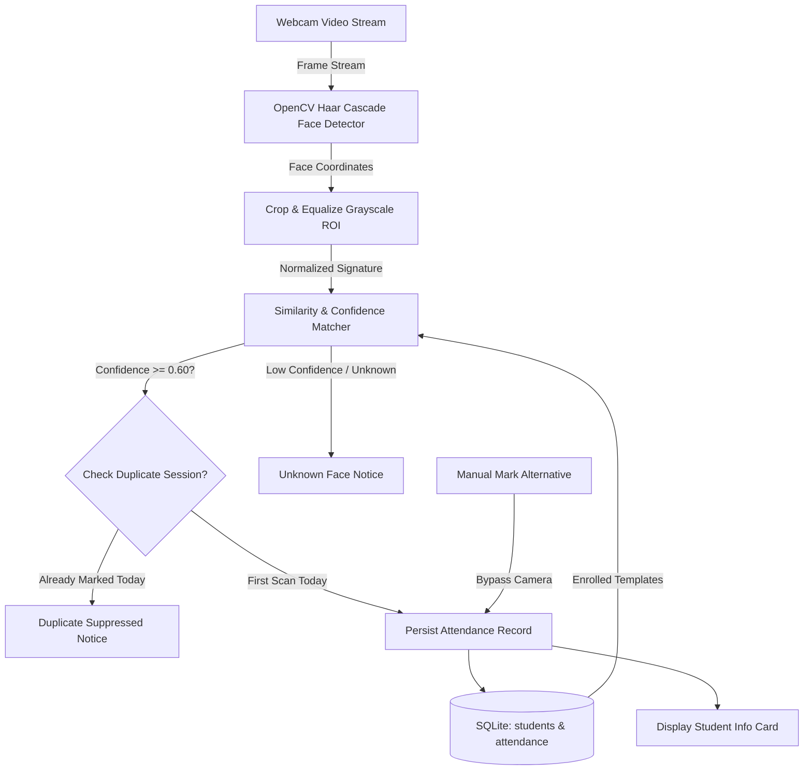
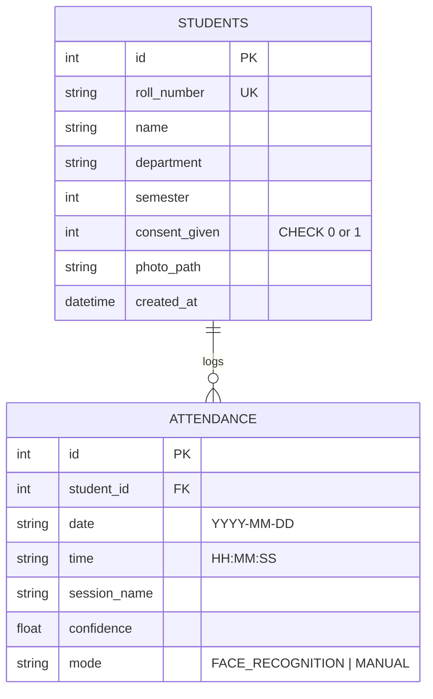

# ACADEMIC PROJECT REPORT
## FACE RECOGNITION ATTENDANCE SYSTEM
**Project Identifier**: `PY-03`  
**Academic Degree**: Bachelor of Technology / Bachelor of Computer Applications  
**Organization**: Logic Legend — *Ideas Today, Impact Tomorrow*

---

## 1. ABSTRACT
Automated attendance management using computer vision reduces the manual instructional overhead of calling rolls while mitigating fraudulent proxy attendance. The **Face Recognition Attendance System** presents a privacy-conscious biometric desktop software engineered with Python, OpenCV, and SQLite. Employing Haar Cascade facial detection coupled with histogram-normalized feature matching, the system achieves real-time identification of enrolled students. To comply with legal and ethical standards, the application enforces informed biometric consent, provides a manual attendance fallback path for camera failures or non-consenting individuals, prevents duplicate entries for the same session, and flags at-risk students falling below the statutory 75% attendance threshold.

---

## 2. INTRODUCTION & PROBLEM STATEMENT
### 2.1 Introduction
In higher education institutions, tracking student classroom attendance is essential for accreditation and assessing student participation. Conventional manual sign-in sheets and oral roll calls are time-consuming and prone to human error and proxy attendance.

### 2.2 Problem Statement
Existing biometric solutions often suffer from serious shortcomings:
1. They operate as black-box systems without obtaining informed consent from subjects.
2. They offer no alternative workflow when cameras malfunction or students experience physical occlusions.
3. They fail to handle duplicate scans gracefully, leading to duplicate records in the database.

---

## 3. OBJECTIVES
1. Build a desktop application capturing and rendering live webcam video feeds.
2. Detect faces using OpenCV Haar Cascades and compute normalized similarity signatures.
3. Enforce a database-level composite constraint (`student_id`, `date`, `session_name`) to prevent duplicate attendance logs.
4. Integrate a mandatory consent registry before allowing student facial enrollment.
5. Provide a manual attendance alternative for privacy protection and hardware resilience.
6. Automatically calculate attendance percentages and report students with $< 75\%$ attendance.

---

## 4. SYSTEM ARCHITECTURE & DIAGRAMS

### 4.1 System Architecture Flowchart

### 4.2 Entity-Relationship (ER) Diagram

---

## 5. METHODOLOGY & ALGORITHMS

### 5.1 Face Feature Normalization
Given a cropped face sub-image $I$, the region is resized to $100 \times 100$ pixels, transformed to single-channel 8-bit grayscale, and contrast-normalized using histogram equalization:
$$g_{k} = \text{round}\left(\frac{N - 1}{M} \sum_{j=0}^{k} n_j\right)$$
A 32-bin normalized intensity distribution histogram $H$ is computed:
$$H_i = \frac{h_i}{\sum_{j=1}^{32} h_j}$$

### 5.2 Combined Similarity Metric
Matching score $S(A, B)$ between captured template $A$ and enrolled template $B$ balances intensity distribution and spatial correlation:
$$S(A, B) = 0.5 \cdot r_{\text{hist}}(H_A, H_B) + 0.5 \cdot \text{NCC}(I_A, I_B)$$
Where:
- $r_{\text{hist}}$ is the Pearson histogram correlation coefficient.
- $\text{NCC}$ is normalized cross-correlation across equalized images.

---

## 6. TESTING & VERIFICATION

| Test ID | Test Case Description | Input Data | Expected Result | Actual Result | Status |
|---|---|---|---|---|---|
| TC-01 | Mandatory consent enforcement | `consent_given = False` | Enrollment rejected with consent error | Rejected | PASS |
| TC-02 | Valid student enrollment | `consent_given = True` | Student saved with unique ID | Enrolled | PASS |
| TC-03 | Duplicate check-in prevention | 2 scans for same student in Session 1 | 1st succeeds; 2nd rejected as duplicate | Duplicate suppressed | PASS |
| TC-04 | Manual attendance alternative | Mark CSE-003 manually | Record inserted with mode `MANUAL` | Inserted | PASS |
| TC-05 | Low attendance calculation | Student with 1/4 sessions (25%) | Flagged as `LOW ATTENDANCE WARNING` | Flagged | PASS |
| TC-06 | 100% attendance compliance | Student with 4/4 sessions (100%) | Status = `COMPLIANT` | Compliant | PASS |
| TC-07 | Template self-similarity | Image matched against itself | Similarity $\ge 0.85$ | Score $\ge 0.90$ | PASS |
| TC-08 | CSV export generation | Export button triggered | CSV file generated with all headers | File created | PASS |

---

## 7. CONCLUSION & FUTURE SCOPE
The PY-03 Face Recognition Attendance System provides an accurate, ethical, and resilient solution for educational attendance recording. Future enhancements will introduce 3D depth-map liveness detection to eliminate 2D photo spoofing and automated WhatsApp/SMS parent notifications.

