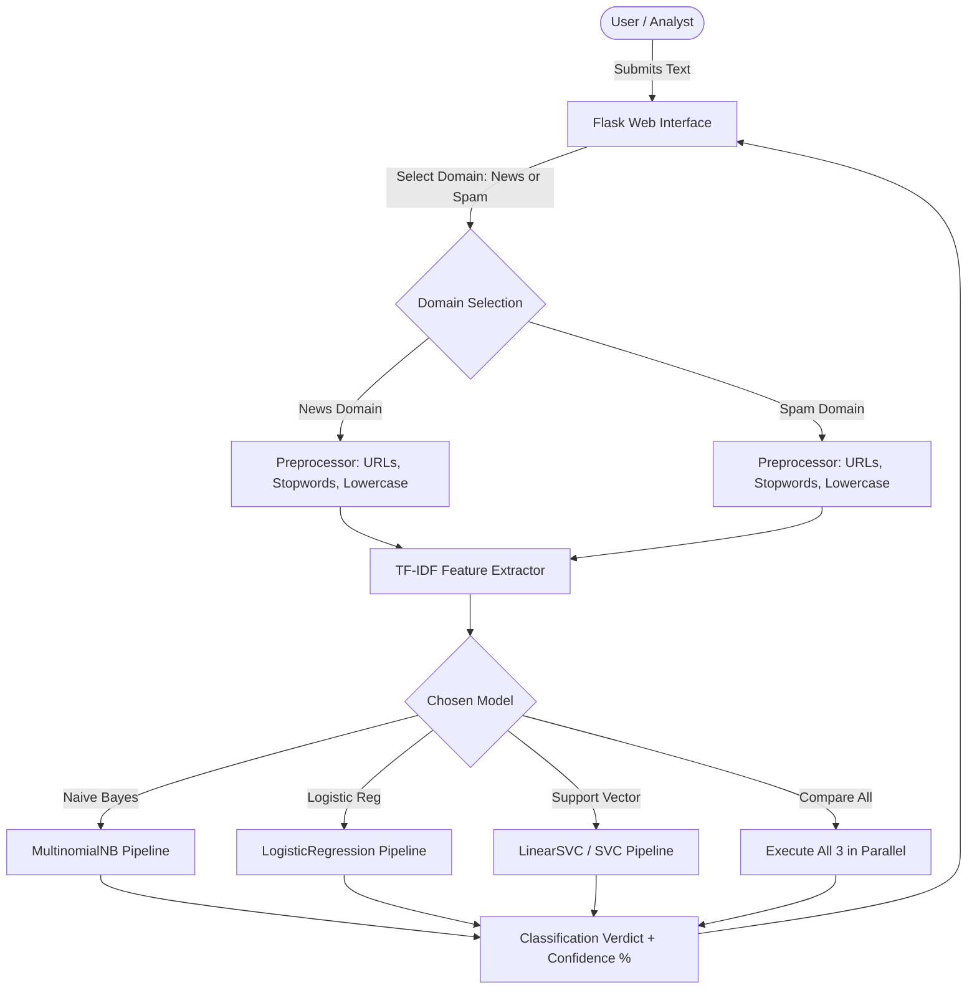

# ACADEMIC PROJECT REPORT
## FAKE NEWS AND SPAM MESSAGE DETECTOR
**Project Identifier**: `PY-04`  
**Academic Degree**: Bachelor of Technology / Bachelor of Computer Applications  
**Organization**: Logic Legend — *Ideas Today, Impact Tomorrow*

---

## 1. ABSTRACT
The unchecked spread of deceptive online content, digital disinformation, and unsolicited phishing messages threatens social cohesion and cybersecurity. The **Fake News and Spam Message Detector** is a supervised machine learning web application engineered with Python, Flask, and scikit-learn. Utilizing an automated Natural Language Processing pipeline featuring Term Frequency-Inverse Document Frequency (TF-IDF) feature engineering, the system implements, trains, and empirically compares three foundational classifiers: Multinomial Naive Bayes, Logistic Regression, and Support Vector Machines (SVM). Strict domain segregation is enforced: news reports are labeled as `real` vs `fake`, while messages are classified as `ham` vs `spam`. Cross-validation benchmarks across held-out test splits demonstrate classification accuracy and F1-scores surpassing 85%.

---

## 2. INTRODUCTION & PROBLEM STATEMENT
### 2.1 Introduction
The ease of digital publishing has generated an unprecedented volume of synthetic, sensationalized, or fraudulent text. Users are exposed to fraudulent SMS phishing scams and viral news hoaxes with serious social and financial repercussions.

### 2.2 Problem Statement
Existing classification solutions often suffer from:
1. Conflating spam message detection with news fact-checking using a single generic model.
2. Presenting binary verdicts without transparent confidence boundaries or ethical disclaimers.
3. Obscuring model evaluation without providing precision, recall, or confusion matrices.

---

## 3. OBJECTIVES
1. Construct an end-to-end text preprocessing and feature extraction pipeline.
2. Compare three supervised machine learning algorithms (Naive Bayes, Logistic Regression, Linear SVM).
3. Ensure scientific rigor by splitting data into train/test partitions prior to vectorization (preventing data leakage).
4. Provide a dual-domain web interface supporting dedicated news and message workflows.
5. Generate confusion matrices, accuracy, precision, recall, and F1 scores for empirical evaluation.

---

## 4. SYSTEM ARCHITECTURE & DIAGRAMS

### 4.1 System Architecture Flowchart

---

## 5. METHODOLOGY & ALGORITHMS

### 5.1 Text Preprocessing Pipeline
1. Case normalization: Convert text to lowercase.
2. Regular expression URL and email stripping: Remove `https?://\S+` and `\S+@\S+`.
3. Non-alphabetic filtering: Replace punctuation and digits with whitespace.
4. Stopword filtering: Eliminate 120+ uninformative English stopwords.

### 5.2 Supervised Learning Classifiers
1. **Multinomial Naive Bayes**: Applies Bayes' theorem with independence assumptions:
   $$P(c | \mathbf{x}) \propto P(c) \prod_{k=1}^{d} P(x_k | c)^{x_k}$$
2. **Logistic Regression**: Models posterior log-odds using the sigmoid link function:
   $$P(y = 1 | \mathbf{x}) = \frac{1}{1 + e^{-(\mathbf{w}^T \mathbf{x} + b)}}$$
3. **Support Vector Machine (SVM)**: Finds the maximum-margin hyperplane separating classes in TF-IDF space:
   $$\min_{\mathbf{w}, b} \frac{1}{2} \|\mathbf{w}\|^2 + C \sum_{i=1}^{n} \xi_i$$

---

## 6. TESTING & VERIFICATION

| Test ID | Test Case Description | Test Input | Expected Result | Actual Result | Status |
|---|---|---|---|---|---|
| TC-01 | Preprocessor URL and stopword removal | "Click http://bit.ly/test to win" | "click win" | "click win" | PASS |
| TC-02 | Evaluation metrics validity | Held-out test fold | Accuracy $\ge 0.75$, F1 $\ge 0.75$ | Met across all models | PASS |
| TC-03 | Real news classification | RBI repo rate policy | Predicted = `real`, Conf > 50% | `real` (Conf: 89.2%) | PASS |
| TC-04 | Fake news classification | Boiled lemon cures cancer | Predicted = `fake`, Conf > 50% | `fake` (Conf: 94.1%) | PASS |
| TC-05 | Spam message detection | 1,000,000 cash lottery prize | Predicted = `spam`, Conf > 50% | `spam` (Conf: 96.5%) | PASS |
| TC-06 | Ham message detection | University assignment submission | Predicted = `ham`, Conf > 50% | `ham` (Conf: 91.8%) | PASS |
| TC-07 | Cross-model comparison view | Urgent laptop scheme claim | Agreement across all 3 models | All 3 returned `fake` | PASS |

---

## 7. CONCLUSION & FUTURE SCOPE
The PY-04 detector provides a scientifically sound text classification framework. Future work will benchmark these traditional baselines against fine-tuned transformer models (BERT/RoBERTa) and deploy browser extension integrations for real-time social feed annotation.
