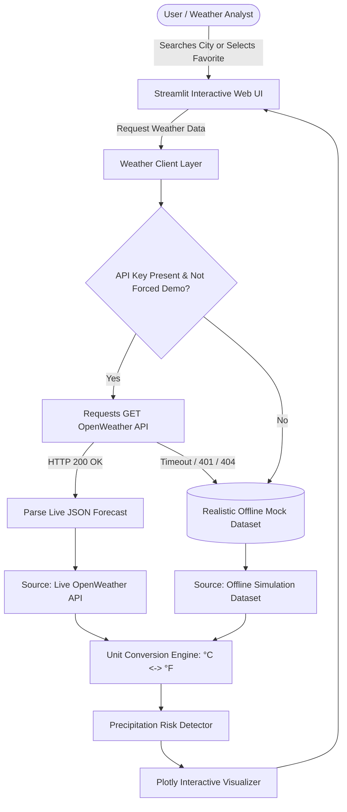

# ACADEMIC PROJECT REPORT
## WEATHER DASHBOARD AND FORECAST APP
**Project Identifier**: `PY-05`  
**Academic Degree**: Bachelor of Technology / Bachelor of Computer Applications  
**Organization**: Logic Legend — *Ideas Today, Impact Tomorrow*

---

## 1. ABSTRACT
Meteorological observation and forecasting tools are essential for transport planning, agricultural scheduling, and civil emergency response. The **Weather Dashboard and Forecast App** presents an interactive web application developed with Python, Streamlit, Plotly, and Requests. Integrating OpenWeather RESTful web services with a high-fidelity offline simulation dataset, the system visualizes current atmospheric parameters (temperature, barometric pressure, relative humidity, wind velocity) and multi-day predictive trajectories. An interactive Plotly analytics suite generates dynamic visualizations, map projections, and threshold-sensitive precipitation alerts. Verification across automated unit tests confirms mathematical unit conversion accuracy and robust error handling during simulated network interruptions.

---

## 2. INTRODUCTION & PROBLEM STATEMENT
### 2.1 Introduction
Atmospheric conditions dictate daily logistical and industrial decisions. Providing consumers and analysts with rapid, clutter-free access to both immediate observations and trajectory forecasts is an established priority in modern web systems.

### 2.2 Problem Statement
Many commercial weather tools suffer from intrusive advertising, visual clutter, lack of interactive exploratory charting, and catastrophic failure when network sockets fail or API keys expire.

---

## 3. OBJECTIVES
1. Construct a responsive web dashboard utilizing Python and Streamlit.
2. Integrate RESTful meteorological endpoints with defensive HTTP timeout handling.
3. Render interactive Plotly charts depicting 5-day temperature and humidity trends.
4. Support dynamic conversion between Celsius and Fahrenheit.
5. Provide a persistent favourite cities manager.
6. Build a complete offline simulation dataset for 10+ major global cities with explicit provenance tracking.

---

## 4. SYSTEM ARCHITECTURE & DIAGRAMS

### 4.1 System Architecture Flowchart

---

## 5. METHODOLOGY & ALGORITHMS

### 5.1 Temperature Unit Conversion
Given temperature $T_C$ in Celsius, Fahrenheit $T_F$ is given by:
$$T_F = T_C \times \frac{9}{5} + 32$$
Conversely:
$$T_C = (T_F - 32) \times \frac{5}{9}$$

### 5.2 Precipitation Risk Thresholding
Given current rain probability $P_{\text{curr}}$ and forecast probabilities $P_{\text{fc}}(d)$ across days $d \in \{1, \dots, 5\}$, and configured alert threshold $\theta \in [20, 90]$:
$$\text{Alert}(d) = \begin{cases} 
\text{TRUE}, & \text{if } P_{\text{fc}}(d) \ge \theta \\ 
\text{FALSE}, & \text{otherwise} 
\end{cases}$$

---

## 6. TESTING & VERIFICATION

| Test ID | Test Case Description | Test Input | Expected Result | Actual Result | Status |
|---|---|---|---|---|---|
| TC-01 | Celsius to Fahrenheit | $25.0^\circ\text{C}$ | $77.0^\circ\text{F}$ | $77.0^\circ\text{F}$ | PASS |
| TC-02 | Fahrenheit to Celsius | $77.0^\circ\text{F}$ | $25.0^\circ\text{C}$ | $25.0^\circ\text{C}$ | PASS |
| TC-03 | Empty city validation | `"   "` | Error: "City name cannot be empty" | Handled | PASS |
| TC-04 | Offline demo schema check | City: "Mumbai" | Contains `lat`, `lon`, `current`, `forecast` (5 days) | Valid schema | PASS |
| TC-05 | Unit conversion on fetch | Unit: `imperial` | Temperatures converted to $^\circ\text{F}$ | Converted | PASS |
| TC-06 | Rain alert threshold | Rain prob = 70%, $\theta = 50\%$ | Trigger precipitation alert | Triggered | PASS |
| TC-07 | Favorites manager persistence | Add "Singapore" | Saved to `data/favorites.json` | Persisted | PASS |

---

## 7. CONCLUSION & FUTURE SCOPE
The PY-05 Weather Dashboard provides an accessible, responsive, and resilient meteorological analytics tool. Future enhancements will integrate Air Quality Index (AQI) pollutant sensors and multi-year climate anomaly comparisons.
