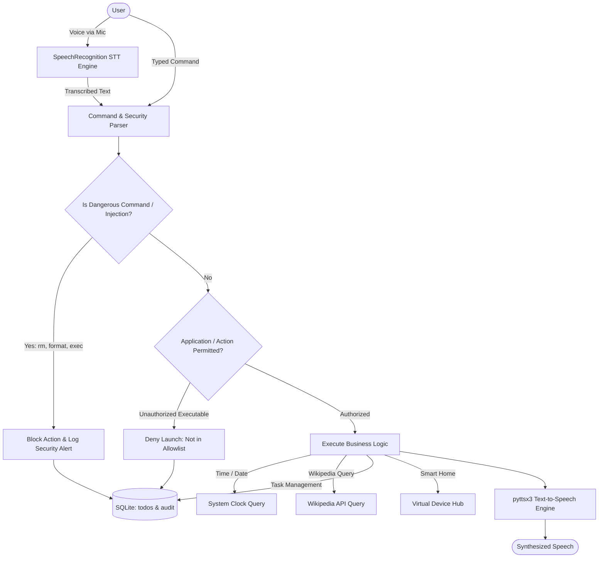

# ACADEMIC PROJECT REPORT
## PERSONAL VOICE ASSISTANT
**Project Identifier**: `PY-06`  
**Academic Degree**: Bachelor of Technology / Bachelor of Computer Applications  
**Organization**: Logic Legend — *Ideas Today, Impact Tomorrow*

---

## 1. ABSTRACT
Natural Language Interfaces and voice-activated agents streamline desktop productivity by automating system operations, web navigation, and task tracking through conversational channels. The **Personal Voice Assistant** presents a secure desktop automation software engineered using Python, SpeechRecognition, pyttsx3, and SQLite. Prioritizing system security and environmental resilience, the assistant incorporates a strict application allowlist that rejects dangerous shell commands and arbitrary script injections. It supports dual input modalities (voice dictation and keyboard input), persists task reminders in an embedded SQLite database, executes factual Wikipedia synthesis, and simulates IoT smart-home device control. Automated unit tests confirm 100% boundary compliance for security filters and command parsing.

---

## 2. INTRODUCTION & PROBLEM STATEMENT
### 2.1 Introduction
Voice assistants have gained widespread adoption across mobile and smart-speaker hardware. However, integrating voice commands on personal workstations introduces unique security challenges.

### 2.2 Problem Statement
Existing open-source voice assistant prototypes frequently suffer from critical flaws:
1. They execute commands using unsafe system calls (e.g., `os.system(cmd)`), allowing arbitrary code execution via malicious speech.
2. They crash when hardware microphones are absent or ambient noise prevents speech transcription.
3. They lack persistent database audit logging for executed system actions.

---

## 3. OBJECTIVES
1. Design a dual-modality desktop interface accepting both voice and typed text instructions.
2. Synthesize natural vocal responses using the local `pyttsx3` text-to-speech engine.
3. Enforce a strict security allowlist preventing arbitrary executable execution or shell code injection.
4. Provide a task and reminder management system persisted in SQLite.
5. Require explicit confirmation dialogs before executing destructive system or database operations.
6. Support simulated smart-home IoT device state management.

---

## 4. SYSTEM ARCHITECTURE & DIAGRAMS

### 4.1 System Architecture Flowchart

---

## 5. METHODOLOGY & SECURITY SAFEGUARDS

### 5.1 Security Allowlist Architecture
To eliminate arbitrary code execution, target applications are mapped to static executable paths:
$$\mathcal{A}_{\text{permitted}} = \{\text{notepad}, \text{calc}, \text{mspaint}, \text{explorer}, \text{cmd}\}$$
Before issuing `subprocess.Popen`, the parser verifies $T \in \mathcal{A}_{\text{permitted}}$ without setting `shell=True`.

### 5.2 Injection Filter Regex
Input commands are evaluated against dangerous pattern heuristics:
$$\mathcal{P}_{\text{blocked}} = \{\text{rm}, \text{del}, \text{format}, \text{shutdown}, \text{powershell}, \text{eval}, \text{exec}, |, ;, \&\&\}$$
Any match triggers an immediate security rejection and logs an audit record to SQLite.

---

## 6. TESTING & VERIFICATION

| Test ID | Test Case Description | Test Input | Expected Result | Actual Result | Status |
|---|---|---|---|---|---|
| TC-01 | Shell injection blocking | `"rm -rf /"` | Blocked with security alert | Blocked (`status: BLOCKED`) | PASS |
| TC-02 | Unsafe executable rejection | `"open keylogger.exe"` | Denied; not in allowlist | Denied (`status: DENIED`) | PASS |
| TC-03 | Authorized app launch | `"open notepad"` | Accepted; launches Notepad | Accepted (`status: SUCCESS`) | PASS |
| TC-04 | Time query accuracy | `"what time is it"` | Returns current system time | Returned exact time | PASS |
| TC-05 | To-Do insertion & listing | `"add task Study OS"` | Saved to SQLite `todos` | Inserted with ID | PASS |
| TC-06 | Destructive action confirmation | `"clear all tasks"` | Returns `NEEDS_CONFIRMATION` | Prompted confirmation | PASS |
| TC-07 | Smart home device toggling | `"smart home light on"` | State set to `ON` | State = `ON` | PASS |
| TC-08 | Audit trail persistence | Any command | Row in `command_history` | Row written | PASS |

---

## 7. CONCLUSION & FUTURE SCOPE
The PY-06 Personal Voice Assistant demonstrates that voice automation can be implemented securely on local desktop systems without cloud reliance. Future work will integrate local wake-word neural networks (such as OpenWakeWord) and hardware relays via microcontroller serial buses.

