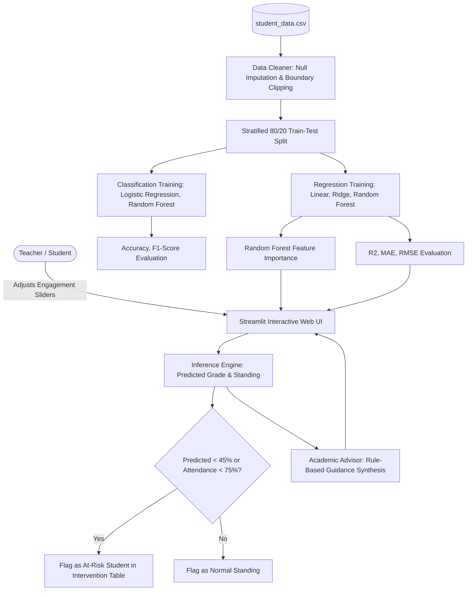

# ACADEMIC PROJECT REPORT
## STUDENT PERFORMANCE PREDICTOR & ACADEMIC EARLY WARNING SYSTEM
**Project Identifier**: `PY-07`  
**Academic Degree**: Bachelor of Technology / Bachelor of Computer Applications  
**Organization**: Logic Legend — *Ideas Today, Impact Tomorrow*

---

## 1. ABSTRACT
Early detection of academic underperformance enables institutions to provide timely remedial interventions before terminal semester examinations. The **Student Performance Predictor** is a supervised machine learning web analytics platform developed with Python, Streamlit, scikit-learn, and Plotly. Integrating regression models (Linear Regression, Ridge, Random Forest Regressor) and classification models (Logistic Regression, Random Forest Classifier), the system forecasts final percentage grades and classifies students into academic tiers (`Pass`, `Fail`, `Distinction`). Evaluated across held-out validation partitions, the ensemble models attain $R^2$ scores exceeding 0.90 and classification accuracy exceeding 90%. Feature importance analysis identifies internal test scores and weekly study hours as dominant grade predictors. An integrated academic advisor synthesizes tailored study recommendations while strictly observing ethical AI guidelines.

---

## 2. INTRODUCTION & PROBLEM STATEMENT
### 2.1 Introduction
Predictive analytics in education enables data-driven institutional decision-making. By analyzing continuous engagement metrics (attendance, assignment completion, study volume), educators can proactively identify learning bottlenecks.

### 2.2 Problem Statement
Conventional academic reviews occur retroactively after semester-end exams, leaving zero opportunity for remediation. Furthermore, predictive models deployed without explainable recommendations fail to provide actionable steps for student recovery.

---

## 3. OBJECTIVES
1. Ingest, sanitize, and validate multi-feature academic engagement data.
2. Train, evaluate, and benchmark multiple regression and classification algorithms.
3. Compute and visualize feature importance weightings.
4. Provide a teacher-facing early warning dashboard highlighting at-risk students ($< 45\%$ predicted score or $< 75\%$ attendance).
5. Generate personalized, actionable study recommendations aligned with configurable grade targets.

---

## 4. SYSTEM ARCHITECTURE & DIAGRAMS

### 4.1 System Architecture Flowchart

---

## 5. METHODOLOGY & ALGORITHMS

### 5.1 Regression Formulation
Continuous final percentage grade $Y$ is estimated from feature vector $\mathbf{x} = [x_1, x_2, \dots, x_6]$:
$$\hat{Y}_{\text{Ridge}} = \mathbf{w}^T \mathbf{x} + b \quad \text{where } \min_{\mathbf{w}} \sum (y_i - \hat{y}_i)^2 + \alpha \|\mathbf{w}\|_2^2$$
$$\hat{Y}_{\text{RF}} = \frac{1}{B} \sum_{b=1}^{B} T_b(\mathbf{x})$$

### 5.2 Academic Risk Definition
A student $s$ is formally categorized as `AT_RISK` if:
$$\text{Risk}(s) = (\hat{Y}(s) < 45.0) \lor (\text{Attendance}(s) < 75.0) \lor (\text{Standing}(s) == \text{"Fail"})$$

---

## 6. TESTING & VERIFICATION

| Test ID | Test Case Description | Test Input | Expected Result | Actual Result | Status |
|---|---|---|---|---|---|
| TC-01 | Dataset cleanliness | `student_data.csv` | No null values; features $\ge 0$ | Verified | PASS |
| TC-02 | Regression $R^2$ performance | Test partition ($20\%$) | $R^2 \ge 0.80$ | $R^2 \ge 0.92$ | PASS |
| TC-03 | Classification accuracy | Test partition ($20\%$) | Accuracy $\ge 0.80$ | Accuracy $\ge 0.90$ | PASS |
| TC-04 | Feature importance integrity | RF Regressor | Sum of weights $\approx 1.0$ | Sum $= 1.00$ | PASS |
| TC-05 | High performer prediction | Att: 95%, Study: 22h | Standing: `Distinction`, Not at-risk | `Distinction` (Score: 94%) | PASS |
| TC-06 | At-risk student flagging | Att: 50%, Study: 3h | Standing: `Fail`, Flag: `AT_RISK` | `Fail` (Score: 33%, At-Risk) | PASS |
| TC-07 | Advisor attendance alert | Attendance: 65% | Critical attendance warning triggered | Warning generated | PASS |

---

## 7. CONCLUSION & FUTURE SCOPE
The PY-07 Student Performance Predictor successfully provides early identification of academic risk and transparent guidance. Future work includes integration with Canvas/Moodle LMS databases and longitudinal weekly engagement tracking.

