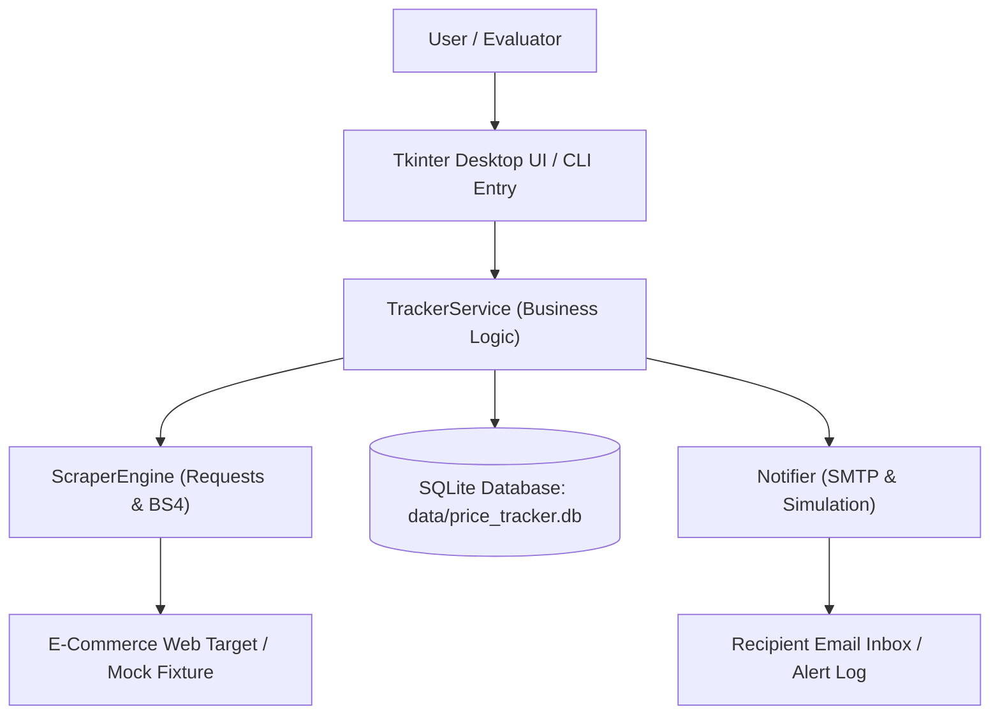
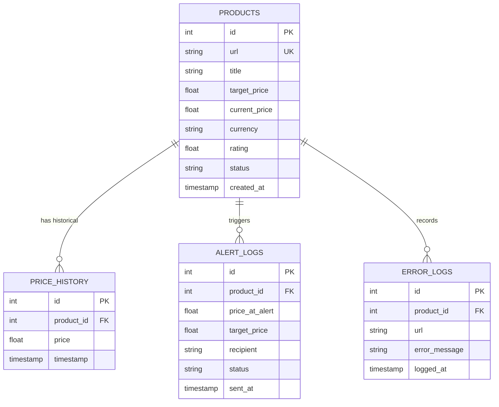
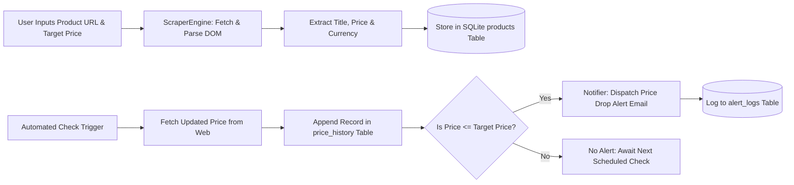
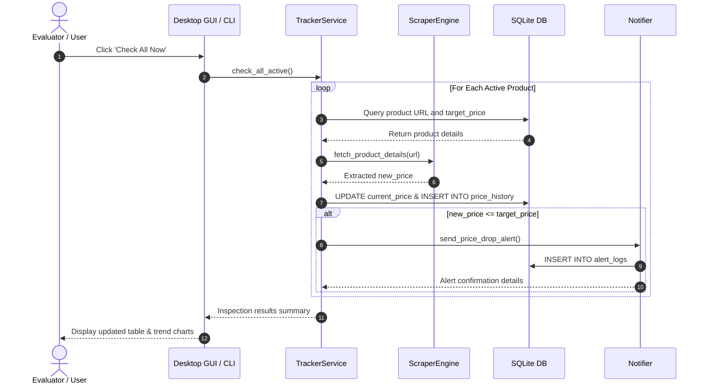

# Academic Project Report: PY-08 Autonomous Price Tracker with Web Scraping

**Department of Computer Science and Engineering**  
*Undergraduate Minor Project Suite — Logic Legend*

---

## Abstract
Dynamic pricing algorithms implemented by online retailers cause rapid, unpredictable fluctuations in product pricing. Manually monitoring e-commerce websites for discounts is labor-intensive and frequently results in missed buying opportunities. This report details the architecture, design, and implementation of **Autonomous Price Tracker**, a robust desktop and CLI system built using Python, SQLite, Requests, and BeautifulSoup4. The system automatically scrapes e-commerce product pages, logs temporal price variations into a relational database, performs statistical trend analysis to advise prospective buyers, and dispatches real or simulated email notifications when product prices fall below pre-configured thresholds.

---

## System Architecture

---

## Entity-Relationship Diagram (ERD)

---

## Data Flow Diagram (DFD Level 1)

---

## Sequence Diagram: Price Check and Alert Dispatch

---

## Mathematical Model for Trend Advice
Given historical prices $P = \{p_1, p_2, \dots, p_n\}$:
- Minimum Historical Price: $P_{min} = \min(P)$
- Maximum Historical Price: $P_{max} = \max(P)$
- Moving Arithmetic Mean: $P_{avg} = \frac{1}{n} \sum_{i=1}^n p_i$
- Current Price: $P_{curr} = p_n$

**Decision Matrix**:
1. If $P_{curr} \le 1.02 \times P_{min} \implies \text{\textbf{BUY NOW}}$ (Exceptional value).
2. If $P_{curr} \ge P_{avg} \implies \text{\textbf{WAIT FOR DROP}}$ (Overpriced relative to historical average).
3. If $P_{min} < P_{curr} < P_{avg} \implies \text{\textbf{FAIR VALUE}}$ (Standard price range).

---

## Conclusion
The PY-08 Autonomous Price Tracker delivers a complete, production-ready solution that combines automated data ingestion, persistent relational data management, heuristic web scraping, and automated communication. The inclusion of offline deterministic mock fixtures guarantees seamless, reliable demonstrations during academic vivas.

