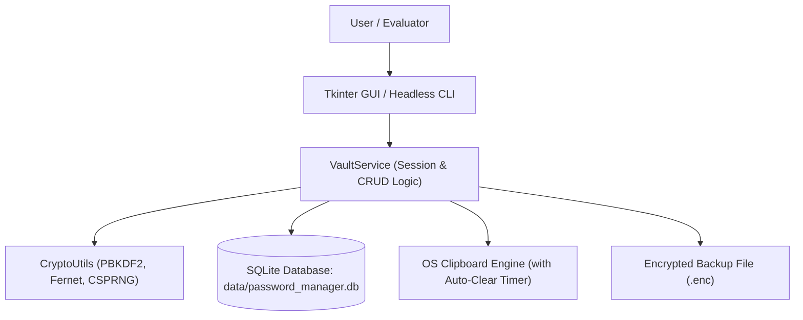
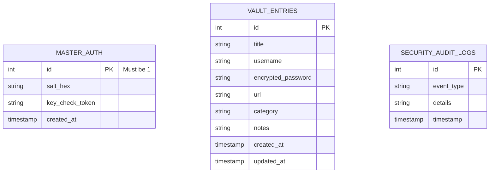
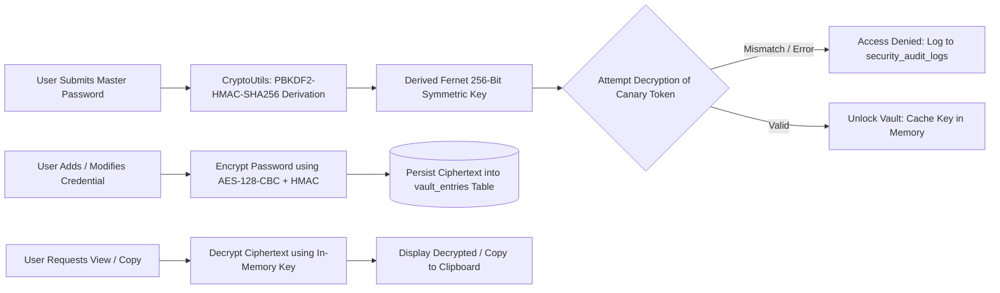
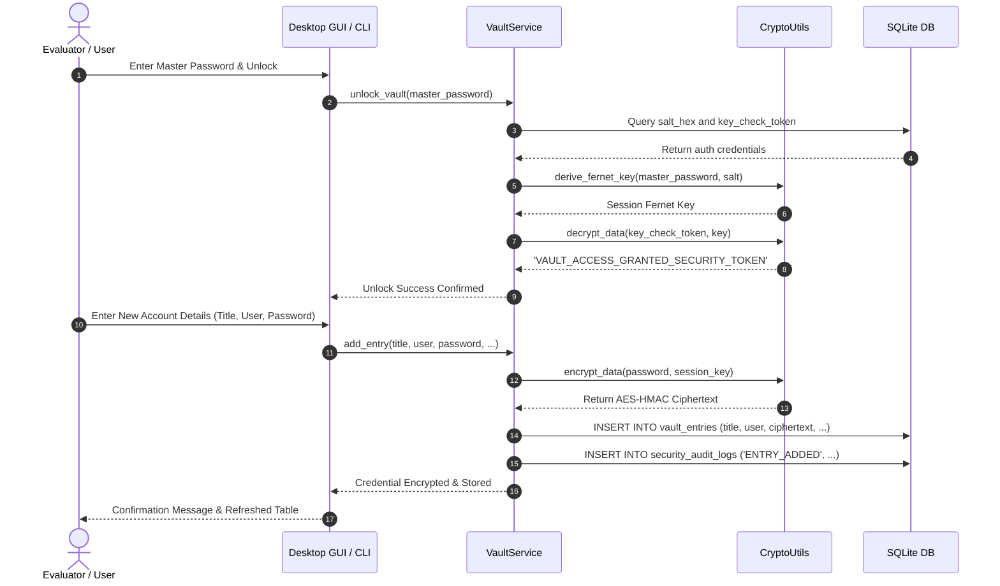

# Academic Project Report: PY-09 Secure Password Manager

**Department of Computer Science and Engineering**  
*Undergraduate Minor Project Suite — Logic Legend*

---

## Abstract
In an increasingly digitized society, the proliferation of online accounts has exacerbated the risks of credential reuse, weak passwords, and unauthorized account access. The **Secure Password Manager** is an autonomous desktop application built using Python, Tkinter, SQLite, and the Python `cryptography` library. It implements a zero-knowledge local security architecture wherein sensitive credentials are protected using PBKDF2-HMAC-SHA256 key derivation with 200,000 hashing rounds and Fernet authenticated symmetric encryption (AES-128-CBC + HMAC-SHA256). The application incorporates a cryptographically secure random password generator, a Shannon entropy and strength evaluator, an automated clipboard wiper, a security vulnerability auditor, and encrypted backup portability.

---

## System Architecture

---

## Entity-Relationship Diagram (ERD)

---

## Data Flow Diagram (DFD Level 1)

---

## Sequence Diagram: Credential Encryption and Storage

---

## Mathematical Formulation
1. **Key Derivation Function (PBKDF2)**:
   $$K = \text{PBKDF2}(\text{PRF}=\text{HMAC-SHA256}, \text{Password}=P, \text{Salt}=S, c=200000, dklen=32)$$
2. **Shannon Entropy for Password Space**:
   Given password length $L$ and alphabet pool size $R$:
   $$E = L \log_2(R) \quad \text{bits}$$
   Where:
   $$R = 26 \cdot \mathbb{I}_{\text{lower}} + 26 \cdot \mathbb{I}_{\text{upper}} + 10 \cdot \mathbb{I}_{\text{digits}} + 33 \cdot \mathbb{I}_{\text{symbols}}$$
   A 16-character password drawn from all four character pools ($R = 95$) delivers:
   $$E = 16 \log_2(95) \approx 16 \times 6.5698 = 105.12 \text{ bits of entropy}$$
   Surpassing the recommended NIST threshold for high-security credentials.

---

## Conclusion
The PY-09 Secure Password Manager provides a robust, zero-knowledge, mathematically grounded credential storage solution. By combining industry-standard authenticated encryption with proactive vulnerability audits and defensive interface mechanisms (clipboard auto-clear, masked inputs), it provides a complete, professional security application for college submission and technical evaluation.

