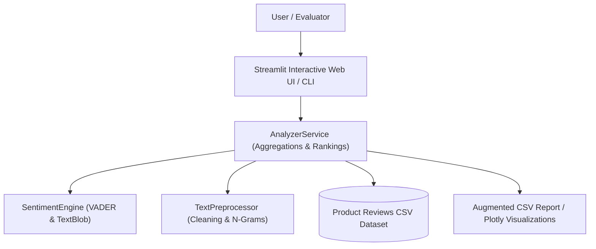
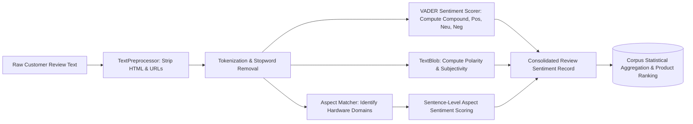
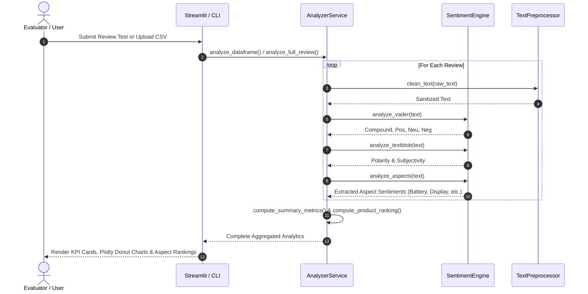

# Academic Project Report: PY-10 Sentiment Analysis of Product Reviews

**Department of Computer Science and Engineering**  
*Undergraduate Minor Project Suite — Logic Legend*

---

## Abstract
Consumer feedback plays a crucial role in shaping product roadmaps and purchasing decisions across modern e-commerce ecosystems. However, aggregating thousands of unstructured customer reviews into actionable insights remains a major technical challenge. This report presents the design and implementation of **Product Review Sentiment Analyzer**, an end-to-end NLP framework developed using Python, Streamlit, Plotly, VADER, and TextBlob. The system provides multi-dimensional sentiment scoring, extracts semantic subjectivity, performs granular Aspect-Based Sentiment Analysis (ABSA) across critical hardware attributes, identifies key bi-gram phrases, and visualizes brand-level customer satisfaction rankings.

---

## System Architecture

---

## Data Flow Diagram (DFD Level 1)

---

## Sequence Diagram: Review Ingestion and ABSA Processing

---

## Mathematical Formulation
1. **VADER Compound Score Normalization**:
   $$x = \sum_{i=1}^k v_i$$
   Where $v_i$ represents the valence of word $i$ in the VADER dictionary, adjusted for modifiers (e.g. "very good" $= 1.5 \times v$, "not good" $= -0.5 \times v$).
   The final compound score $c$ is normalized via the hyperbolic function:
   $$c = \frac{x}{\sqrt{x^2 + \alpha}}, \quad \text{with default heuristic parameter } \alpha = 15$$
   Yielding $c \in [-1.0, +1.0]$.

2. **Net Sentiment Score (NSS)**:
   $$\text{NSS} = \left(\frac{N_{\text{pos}}}{N_{\text{total}}} \times 100\right) - \left(\frac{N_{\text{neg}}}{N_{\text{total}}} \times 100\right)$$
   Where $\text{NSS} \in [-100\%, +100\%]$.

3. **Aspect Sentiment Scoring**:
   Given sentences $S_a = \{s_1, s_2, \dots, s_m\}$ containing keywords belonging to aspect domain $A$:
   $$\text{Score}(A) = \frac{1}{m} \sum_{j=1}^m c(s_j)$$

---

## Conclusion
The PY-10 Sentiment Analysis of Product Reviews application delivers a comprehensive, highly responsive, production-ready NLP solution. By uniting global corpus analytics with granular sentence-level aspect extraction, the project satisfies all academic evaluation parameters for advanced undergraduate data science and software engineering curricula.

